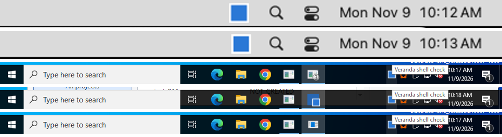
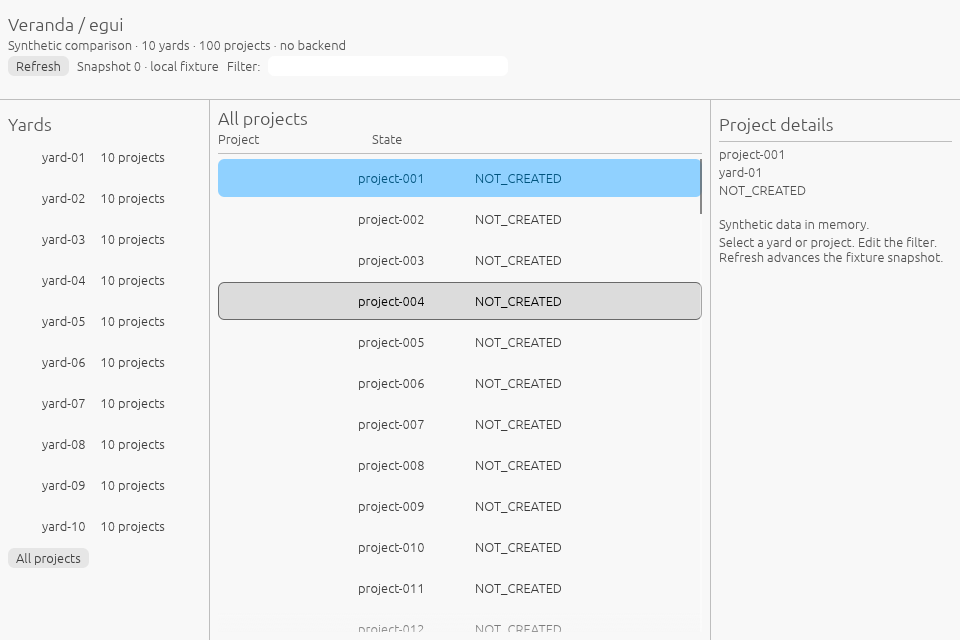
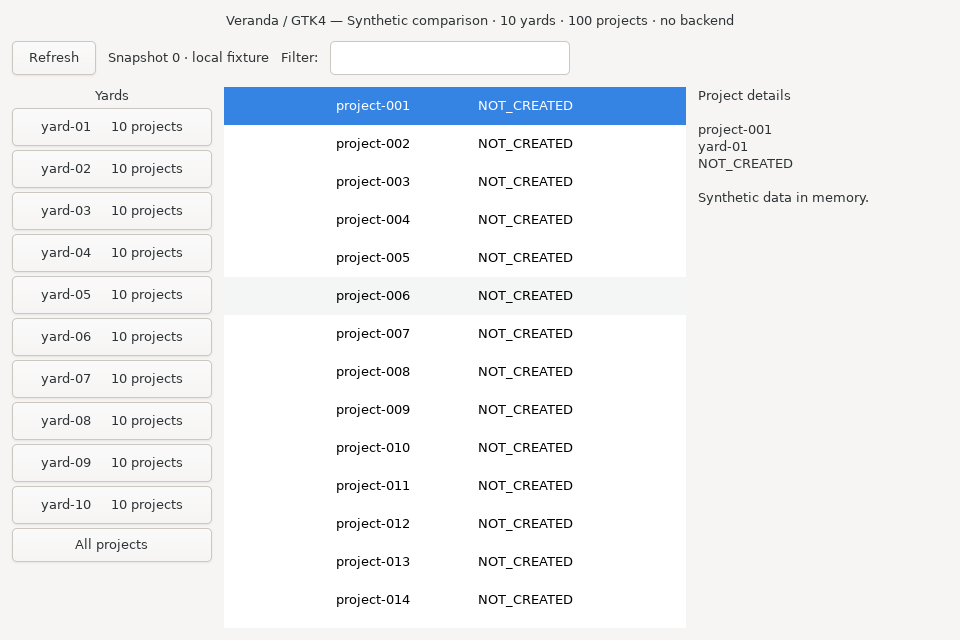
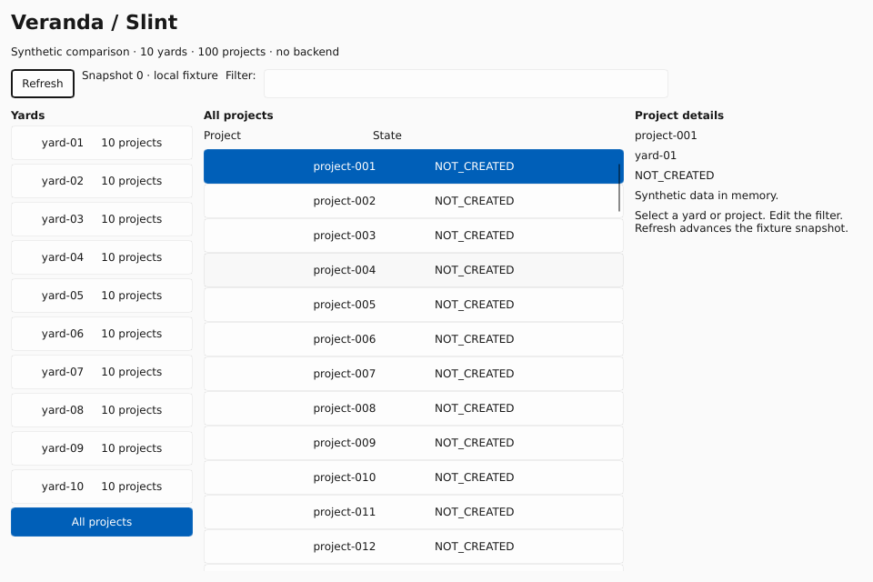
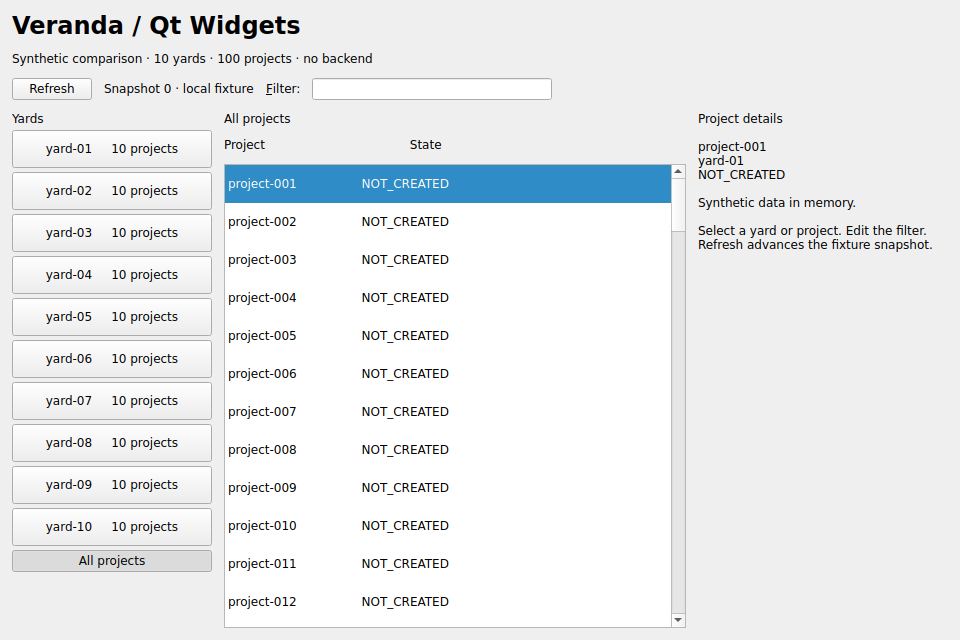
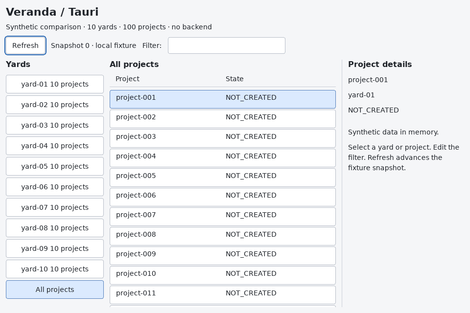
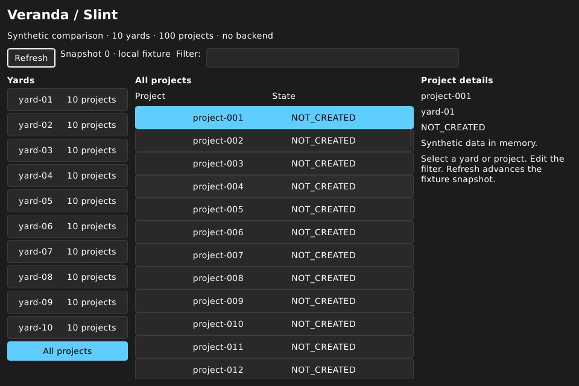

# Rust desktop GUI comparison

**[Open the interactive comparison →](https://heyvasily.github.io/rust-desktop-comparison/)**
&nbsp;·&nbsp; [Native features](docs/features.md)
&nbsp;·&nbsp; [Desktop baseline](docs/desktop-integration.md)
&nbsp;·&nbsp; [Historical measurements](docs/full-native-results.md)
&nbsp;·&nbsp; [Historical raw data](measurements/native-matrix-2026-11-09/summary.csv)
&nbsp;·&nbsp; [Methodology](docs/methodology.md)

The same small desktop interface built five times — **egui/eframe, GTK4 (gtk4-rs),
Slint, Qt Widgets and Tauri** — with a sourced comparison of platform integration,
reproducible probes and historical measurements on Windows, macOS and Linux.
The current default builds target a **desktop-integrated baseline**. The five-run
2026-11-09 series below is preserved as a **historical UI-only** profile, not
reassigned to the updated binaries.

Every example shows 10 synthetic yards and 100 projects: navigation, selection,
scrolling, an editable filter and a Refresh button that advances an in-memory
snapshot. There is no backend or periodic work. Measurements describe the stated
fixture, enabled features and rendering environment; they are not universal
toolkit memory floors or the total cost of a production application.

| Framework | Language here | UI model | Example |
| --- | --- | --- | --- |
| egui/eframe 0.37.0 | Rust | Immediate mode, own drawing (OpenGL/wgpu) | [main.rs](examples/egui/src/main.rs) |
| GTK4 via gtk4-rs 0.11.5 + libadwaita | Rust | Retained widget tree, system-following libadwaita style | [main.rs](examples/gtk/src/main.rs) |
| Slint 1.18.1 | Rust + `.slint` markup | Declarative, own renderer (software here) | [main.slint](examples/slint/ui/main.slint) |
| Qt Widgets | C++17 | Retained widget tree, platform styles | [main.cpp](examples/qt/main.cpp) |
| Tauri 2.12.5 | Rust + HTML/CSS/JS | System webview | [index.html](examples/tauri/frontend/index.html) |

## Current desktop baseline

**Both egui and GTK support dark appearance.** Drawing a dark palette, selecting
it from the OS at startup, and updating it while the same process remains open
are different capabilities. The old red crosses below record failures of the
old example's startup integration, not an inability to render dark controls.

The normal profile includes:

- **egui:** eframe's real OS `clipboard`, browser `links` and `system_fonts`
  features, in addition to the existing fonts, AccessKit and renderers; an
  event-driven Linux Settings portal bridge; native winit theme input on
  Windows/macOS. The old explicit feature list omitted those three default
  eframe features. Without `clipboard`, internal copy/paste can work while
  external clipboard interoperability is absent.
- **GTK4 + libadwaita:** the normal `desktop` feature initializes libadwaita's
  system-following style manager. Include the native libadwaita runtime and its
  memory; the old bare-GTK numbers are not measurements of this profile.
- **Qt:** modern Qt and the matching desktop platform-theme integration. The
  Linux GNOME profile uses Qt 6.8.3 with its matching GTK3 theme plugin and
  Settings portal. GTK3 and QtDBus loaded by that plugin belong in the measured
  app process. Do not substitute the old Qt 6.4/generic-theme result or mix a
  distribution plugin with a different Qt kit.
- **Every candidate:** actual text widgets and external clipboard acceptance,
  system-theme startup and same-process light → dark → light transitions,
  followed by restored fixture state and idle sampling.

The [desktop report](docs/desktop-integration.md) describes the exact profile,
acceptance evidence and remaining gaps. A primary desktop result requires all
mandatory checks to pass **before** memory sampling. Missing portal support,
failed clipboard checks, incomplete process scope and unrun tests remain visible;
they are not green ticks or zero-memory observations.

The `egui_reduced` build is a **separate diagnostic control**, built from the same
source with `--no-default-features`. It is not eligible for the desktop ranking.
Paired runs keep the host, toolchain, renderer, final palette and sampling fixed,
but only the integrated build exercises external clipboard and theme changes.
Their delta is the **whole profile's footprint after use**, not a clipboard-only
allocation. Dependency count, executable size and comparisons with an old runner
cannot establish that difference.
There is no assumption that desktop integration adds either a large or a small
amount of resident memory. Optional tray, global shortcuts and single-instance
checks remain a [separate profile](docs/shell-integration.md).

## Historical UI-only idle memory on three operating systems

These are the unchanged 2026-11-09 results. External clipboard and live theme
changes were not exercised before these samples; they do **not** quantify the
updated desktop profile above.

Memory of the whole application process family (including webview helpers) with a
960×640 window, as each OS's own monitor reports it: **Linux PSS**, **Windows
private working set** (Task Manager) and **macOS physical footprint** (Activity
Monitor). Median of five runs on separate VMs, with the range in brackets.
**Lower is better.** Compare rows within a column.

| Framework | Linux PSS, MiB | Windows private WS, MiB | macOS footprint, MiB |
| --- | ---: | ---: | ---: |
| egui / eframe | 96.4 [95.9–96.6] | 26.9 [26.3–29.4] | 28.2 [27.3–30.6] |
| GTK4 (gtk4-rs) | 211.7 [211.5–212.0] | 33.2 [33.0–33.4] | 43.7 [36.0–46.1] |
| Slint | **17.5** [17.4–17.7] | **9.0** [9.0–9.1] | **17.1** [16.9–17.2] |
| Qt Widgets | 23.0 [22.9–23.0] | 15.0 [15.0–15.2] | 24.2 [24.1–24.5] |
| Tauri | 338.2 [337.1–340.1] | 116.2 [115.9–116.4] | 40.8 [40.4–41.1] |

Idle CPU stayed below 0.11 % of one core in this series, too small to rank. The
[full report](docs/full-native-results.md) adds summed RSS / Working Set, CPU,
outliers, executable sizes and versions.

> [!NOTE]
> **How to read these numbers.** The primary metrics are not interchangeable.
> Linux PSS apportions shared pages; Windows private working set excludes shared
> pages; macOS physical footprint is macOS memory-accounting data, not Linux PSS.
> Summed RSS may double-count shared pages (Tauri on Linux: 501 MiB summed RSS →
> 338 MiB PSS). Linux ran under X11/Xvfb with Mesa llvmpipe, not native Wayland
> or a hardware GPU;
> GL-based toolkits (GTK 4.14, egui) carry its private allocations there, and the GTK
> renderer was not pinned. These are idle UI-only observations, not startup,
> interaction or frame-rate measurements. Earlier series:
> [2026-11-07 single run with GTK in C](docs/native-matrix-2026-11-07.md) and the
> [backend-connected Wayland measurements](docs/historical-comparison.md#why-the-current-linux-numbers-differ).

## Historical executable size and system-theme startup check

| Framework | Historical executable, Linux / Windows / macOS | Historical startup check, Win / mac / Linux |
| --- | --- | --- |
| egui / eframe | 12.0 / 12.8 / 5.4 MiB | ✅ / ✅ / ❌ |
| GTK4 (gtk4-rs) | 0.4 / 2.1 / 0.4 MiB + GTK runtime | ❌ / ❌ / ❌ |
| Slint | 19.6 / 12.8 / 11.7 MiB | ✅ / ✅ / ✅ |
| Qt Widgets | 0.03 / 0.05 / 0.07 MiB + Qt runtime (49 MiB deployed on Windows) | ❌ / ✅ / ❌ |
| Tauri | 6.6 / 8.2 / 6.3 MiB + system webview | ✅ / ✅ / ✅ (app CSS) |

The old check switched the OS itself to dark and relaunched each example;
see the [captures](docs/full-native-results.md#system-dark-mode). Here ✅ means
that stated test passed and ❌ means it failed. Neither symbol describes whether
the toolkit can render dark colors or whether the updated desktop profile passes
startup/live checks. The executable sizes likewise belong to the old builds.

## Linux: X11 versus Wayland, and GTK's renderer

Two historical controlled Linux series help explain the differences above. They
do not replace desktop acceptance or measure the current integrated builds.

**[GTK renderer experiment](docs/gtk-memory-investigation.md).** One GTK 4.14
binary (the [C control](examples/gtk-c/main.c)) on one Ubuntu runner: the default
OpenGL renderer under Mesa llvmpipe used **238.36 MiB RSS / 209.67 MiB PSS**, while
`GSK_RENDERER=cairo` used **97.87 / 67.86 MiB**. On Debian, X11/Cairo still loaded
Mesa/LLVM (119.45 MiB); disabling GL/Vulkan as well gave 31.68 MiB with
byte-identical screenshots. The 212 MiB gtk4-rs PSS above uses the same default
renderer, so it is mostly the software-GL path, not GTK's widget tree.

**[Paired X11 and native Wayland](docs/linux-display-comparison.md).** One binary per
framework on one Ubuntu 24.04 runner, X11 (Xvfb/Openbox) versus native Wayland
(labwc), median application-family MiB:

| Framework | X11 RSS | Wayland RSS | X11 PSS | Wayland PSS |
| --- | ---: | ---: | ---: | ---: |
| egui / eframe | 117.25 | 119.25 | 91.81 | 111.45 |
| GTK4 (C control) | 181.18 | 185.89 | 151.29 | 172.42 |
| Slint | 22.77 | 23.25 | 17.50 | 17.61 |
| Qt Widgets | 33.69 | **84.50** | 22.92 | **72.92** |
| Tauri | 492.98 | 500.18 | 323.45 | 342.61 |

Qt on Wayland maps 46.77 MiB of resident LLVM/Gallium that its X11 process does not;
the report separates that observation from a causal claim. Slint barely changes.
These are software-rendered idle runs; compositor memory is excluded.

## Native features and OS integration

Framework APIs, required application integration and explicitly scoped test outcomes.
An available API is not proof of passed acceptance, and a failed example test is
not proof of absent toolkit support.
Every cell links to its source in the [detailed matrix](docs/features.md); the
[per-session platform notes](docs/platform-support.md) split Linux into X11 and Wayland.

<!-- features:start -->
<!-- Generated by tools/render_features.py from data/features.json. -->
| Capability | egui / eframe | GTK4 | Slint | Qt Widgets | Tauri |
| --- | :---: | :---: | :---: | :---: | :---: |
| Native-looking controls | ❌ | 🟡 Win<br>🟡 mac<br>✅ Linux | 🟡 | ✅ Win<br>✅ mac<br>🟡 Linux | 🟡 |
| Light and dark appearance | ✅ | ✅ | ✅ | ✅ | 🛠️ |
| Historical system-theme startup test | ✔️ Win<br>✔️ mac<br>✖️ Linux | ✖️ | ✔️ | ✖️ Win<br>✔️ mac<br>✖️ Linux | ✔️ |
| Native Wayland and X11 | ✅ | ✅ | ✅ | ✅ | ✅ |
| Translucent window materials | 📦 Win<br>📦 mac<br>❌ Linux | ❌ | 📦 Win<br>📦 mac<br>❌ Linux | 🛠️ | ✅ Win<br>✅ mac<br>❌ Linux |
| System text clipboard | ✅ | ✅ | ✅ | ✅ | ✅ |
| Accessibility bridge | ✅ | 🟡 Win<br>🟡 mac<br>✅ Linux | ✅ | ✅ | ✅ |
| Input methods (CJK, dead keys) | ✅ | ✅ | ✅ | ✅ | ✅ |
| Right-to-left and bidi text | ❌ | ✅ | 🟡 | ✅ | ✅ |
| Native menu bar | 📦 | 🟡 Win<br>✅ mac<br>🟡 Linux | ✅ Win<br>✅ mac<br>🟡 Linux | ✅ | ✅ |
| System tray icon | 📦 | 📦 | ✅ | ✅ | ✅ |
| Native file dialogs | 📦 | ✅ | 📦 | ✅ | 🧩 |
| Desktop notifications | 📦 | ❔ Win<br>❔ mac<br>✅ Linux | 📦 | 🟡 | 🧩 |
| Drag and drop with other apps | 🟡 | ✅ | 🟡 | ✅ | 🟡 |
| Multiple windows | ✅ | ✅ | ✅ | ✅ | ✅ |
| System credential store | 📦 | 📦 | 📦 | 📦 | 📦 |
| Badge on the app icon | 🛠️ | 🛠️ | 🛠️ | ✅ Win<br>✅ mac<br>🟡 Linux | 🟡 Win<br>✅ mac<br>🟡 Linux |
| Progress on the app icon | 🛠️ | 🛠️ | 🛠️ | 🛠️ | ✅ Win<br>✅ mac<br>🟡 Linux |
| Request attention | ✅ | 🛠️ Win<br>🛠️ mac<br>🟡 Linux | 🟡 | ✅ Win<br>✅ mac<br>🟡 Linux | ✅ |
| Dock menu or jump list | 🛠️ | 🛠️ | 🛠️ | 🛠️ Win<br>✅ mac<br>🛠️ Linux | 🛠️ |
| Menu-bar or background-only app | ✅ Win<br>🟡 mac<br>❌ Linux | 🛠️ | 🟡 Win<br>🟡 mac<br>❌ Linux | 🟡 | ✅ |
| Tray clicks and menu | 📦 | 📦 | ✅ Win<br>🟡 mac<br>✅ Linux | ✅ | ✅ Win<br>✅ mac<br>🟡 Linux |
| Global keyboard shortcuts | 📦 Win<br>📦 mac<br>🟡 Linux | 📦 Win<br>❌ mac<br>🟡 Linux | 📦 Win<br>📦 mac<br>🟡 Linux | 📦 Win<br>📦 mac<br>🟡 Linux | 🧩 Win<br>🧩 mac<br>🟡 Linux |
| Start at login | 📦 | 📦 | 📦 | 🛠️ | 🧩 |
| Single instance | 📦 | ✅ Win<br>❌ mac<br>✅ Linux | 📦 | 📦 | 🧩 |
| URL schemes and file associations | 🛠️ | 🟡 Win<br>❔ mac<br>✅ Linux | 🛠️ | 🟡 Win<br>✅ mac<br>🟡 Linux | 🧩 |
| Installers and updates | 📦 | 🟡 Win<br>🟡 mac<br>✅ Linux | 📦 | 🟡 | ✅ |

✅ Built in · 🟡 Partial · 🧩 Official plugin · 📦 Third-party crate · 🛠️ Application/platform code · ❌ Not available · ❔ Not verified · ✔️ Passed stated test · ✖️ Failed stated test. Checked 2026-11-09.
<!-- features:end -->

### Tray, badge, shortcut and single instance, tested

A [separate historical runner check](docs/shell-integration.md) built every example with an
optional `shell-checks` feature and looked for the effect from outside the app.
Tray icons appeared on all three systems for all five toolkits (GTK 4 through the
tray-icon crate); tray clicks reached every app except Tauri on Linux. Qt and Tauri
set Dock/taskbar badges; egui, GTK and Slint have no badge API. Global shortcuts
fired everywhere except inside GTK on macOS, and GTK's built-in single-instance
handling worked on Linux and Windows but not on macOS. Qt 6.4's attention request
was not visible on X11. These checks were not enabled in the historical memory
matrix; their success or failure is not a footprint measurement.



## What the historical interfaces look like

Real **960×640 Linux client captures** from the historical UI-only runs: all projects,
project-001 selected, empty filter. The [interactive page](https://heyvasily.github.io/rust-desktop-comparison/#screenshots)
and the [full gallery](docs/full-native-results.md#interfaces-captured-during-measurement)
show Windows, macOS and the old relaunch-only dark-mode test. These are not
screenshots of the current desktop-integrated builds.

<table>
  <tr>
    <td width="50%"><b>egui / eframe</b><br></td>
    <td width="50%"><b>GTK4 (gtk4-rs)</b><br></td>
  </tr>
  <tr>
    <td><b>Slint</b><br></td>
    <td><b>Qt Widgets</b><br></td>
  </tr>
  <tr>
    <td><b>Tauri / WebKitGTK</b><br></td>
    <td><b>Slint, system dark mode</b><br></td>
  </tr>
</table>

## What the layout code looks like

| Framework | Layout in these examples | State and events |
| --- | --- | --- |
| egui/eframe | Rust panel/widget calls inside `App::ui` | Rust fields; widget responses update state |
| GTK4 (gtk4-rs) | Rust builds persistent `GtkBox`/`ListBox` widgets | GTK signals call Rust closures sharing `Rc<Cell>` state |
| Slint | Declarative `.slint` boxes, properties and repeated rows | Rust models and callbacks update properties |
| Qt Widgets | C++ builds `QWidget`, `QVBoxLayout` and `QHBoxLayout` objects | Qt signals connect to C++ lambdas |
| Tauri | HTML panels, CSS Grid and persistent DOM buttons | JavaScript event handlers; Rust starts the system webview |

Egui declares panels and widgets inside `App::ui`; state updates sit beside click handling.
This example does not request continuous repainting. An excerpt from the
[complete Rust example](examples/egui/src/main.rs):

```rust
egui::Panel::left("yards").exact_size(210.0).show(ui, |ui| {
    ui.heading("Yards");
    if ui.button("All projects").clicked() {
        self.yard = 0;
    }
});
egui::CentralPanel::default().show(ui, |ui| {
    ui.heading("All projects");
    egui::ScrollArea::vertical().show(ui, |ui| {
        // Project buttons update self.project when clicked.
    });
});
```

GTK constructs a persistent widget tree and connects signals to closures. The
[gtk4-rs example](examples/gtk/src/main.rs) mirrors the earlier
[C control](examples/gtk-c/main.c) widget for widget:

```rust
let body = GtkBox::new(Orientation::Horizontal, 12);
let yards = GtkBox::new(Orientation::Vertical, 4);
let projects = ListBox::new();
let scroll = ScrolledWindow::new();
scroll.set_hexpand(true);
scroll.set_child(Some(&projects));
body.append(&yards);
body.append(&scroll);
projects.connect_row_selected(move |_, row| { /* update details */ });
```

These are shortened layout excerpts. The linked files contain the runnable applications.

### Slint: declarative widgets and Rust callbacks

The [layout](examples/slint/ui/main.slint) declares widgets and exposes callbacks;
[Rust](examples/slint/src/main.rs) supplies the filtered model and updates properties:

```slint
ListView {
    for project in root.projects: Button {
        text: project.name + "                 NOT_CREATED";
        height: 38px;
        checkable: true;
        checked: root.selected-project == project.id;
        clicked => { root.choose-project(project.id); }
    }
}
```

This stock Slint example explicitly selects winit/software and enables accessibility.
It does not import the four correctness forks used by the old Slint prototype.

### Qt Widgets: persistent C++ widgets and signals

The [C++ example](examples/qt/main.cpp) creates a widget tree and connects signals:

```cpp
auto *root = new QVBoxLayout(&window);
auto *body = new QHBoxLayout;
body->setSpacing(12);
auto *yards = new QWidget;
yards->setFixedWidth(200);
body->addWidget(yards);
auto *projectLayout = new QVBoxLayout;
auto *projects = new QListWidget;
projectLayout->addWidget(projects);
body->addLayout(projectLayout, 1);  // Expand the center column.
auto *details = new QLabel;
details->setFixedWidth(250);
body->addWidget(details);
root->addLayout(body, 1);
```

Qt Widgets uses native widget/layout APIs here; QML, Qt Quick and WebEngine are absent.

### Tauri: a web layout in a native system webview

The [HTML](examples/tauri/frontend/index.html) and
[CSS](examples/tauri/frontend/style.css) define the panels; ordinary DOM event handlers
in [JavaScript](examples/tauri/frontend/main.js) update the in-memory fixture:

```css
main {
    display: grid;
    grid-template-columns: 200px minmax(0, 1fr) 250px;
    gap: 12px;
}
```

```javascript
filter.addEventListener("input", updateFilter);
document.getElementById("all-projects").addEventListener("click", () => selectYard(0));
document.getElementById("refresh").addEventListener("click", () => {
  state.refreshes += 1;
  document.getElementById("snapshot").textContent = `Snapshot ${state.refreshes} · local fixture`;
});
```

There is no frontend framework, development server or application backend. Tauri uses
different system webviews on each OS, so a Windows result is not a WebKitGTK result.
See [Tauri's webview documentation](https://v2.tauri.app/reference/webview-versions/).

## Original matched Linux measurements — 2026-11-07

Original 1120×768 captures: [egui](screenshots/egui.png) and [GTK4](screenshots/gtk.png).
These historical results use the original source and renderer configuration.

One Debian 13 amd64 disposable VM, four logical CPUs, 4 GiB RAM, Xvfb/Openbox and
software rendering. Both examples ran sequentially on the same display and used the
same window size and data. Each phase settled for 30 seconds, then collected 120
samples over at least 120 seconds.

| Interface | Window | RSS median | PSS median | Idle CPU, one logical core |
| --- | --- | ---: | ---: | ---: |
| egui/eframe 0.37.0, Glow | Visible | 135.52 MiB | 116.26 MiB | 0.008% |
| egui/eframe 0.37.0, Glow | Minimized | 135.52 MiB | 116.25 MiB | 0.017% |
| GTK4 4.18.6 C, Cairo requested | Visible | 120.75 MiB | 95.27 MiB | 0 recorded ticks |
| GTK4 4.18.6 C, Cairo requested | Minimized | 120.75 MiB | 95.26 MiB | 0 recorded ticks |

GTK used **14.77 MiB less RSS** in this pair. Memory median, p95 and observed maximum
were identical within each phase. Both implementations were quiet when idle.

At the measured 100 Hz accounting rate, one CPU tick over 120 seconds is approximately
0.0083% of one core. Zero recorded ticks is below that resolution, not proof of zero
work. One or two ticks do not establish a significant CPU ranking.

Egui's actual OpenGL context reported Mesa llvmpipe software rendering. GTK was asked
to use Cairo; its internal renderer type was not instrumented. These are single-process,
UI-only results, excluding the X server, window manager and accessibility/session services.
They do not establish general toolkit memory floors, hardware-GPU performance or production
application costs. The [historical table](docs/historical-comparison.md) includes backend
processes and a different Wayland environment; its values are not directly comparable.

Read the [full methodology and verification](docs/methodology.md) or inspect the
[four raw sample sets](measurements/2026-11-07/README.md).

## Build and run

The commands below build the **current desktop defaults** on Linux. The original
`tools/measure.py` targets the historical single-process X11 experiment; use
`tools/native_probe.py --desktop-checks` for the current application-family and
desktop-acceptance procedure. The [native runner guide](docs/github-runners.md)
covers Windows/macOS. The original Debian measurements built the
[C control](examples/gtk-c/main.c) with GTK4 4.18.6. You need Rust/Cargo, Python 3, a C compiler,
`pkg-config`, GTK4 **and libadwaita** development libraries, and the X11/OpenGL
development libraries. On Linux, system appearance also needs the graphical
session's Settings portal/backend. The old reproduction package list does not
include every dependency of the new desktop profile; see the
[current method](docs/methodology.md#current-desktop-profile-reproduction).

From this repository's root:

```sh
export CARGO_TARGET_DIR="${CARGO_TARGET_DIR:-$PWD/target}"
mkdir -p "$CARGO_TARGET_DIR"
cargo fmt --manifest-path examples/egui/Cargo.toml --check
cargo build --release --locked --manifest-path examples/egui/Cargo.toml
cargo build --release --locked --manifest-path examples/gtk/Cargo.toml
```

Launch one example at a time in a graphical Linux session:

```sh
"$CARGO_TARGET_DIR/release/veranda-egui-comparison"
# After closing egui:
"$CARGO_TARGET_DIR/release/veranda-gtk-comparison"
```

The binary name and GTK application ID retain the original experiment's names.
The examples require no Subyard installation, cache helper or account. Desktop
services such as the session bus and Settings portal are integration prerequisites,
not an application backend.

To build the reduced egui control without overwriting the desktop executable:

```sh
CARGO_TARGET_DIR="$PWD/target/egui-reduced" \
  cargo build --release --locked --no-default-features \
    --manifest-path examples/egui/Cargo.toml
```

This is the `egui_reduced` diagnostic candidate, not the normal application.
For desktop acceptance and controlled sampling, follow the
[current method](docs/methodology.md#current-desktop-profile-reproduction).
For the original 2026-11-07 software-rendering experiment, use the recorded source
revision and [historical commands](docs/methodology.md#reproduce).

For the additional applications, follow their standalone instructions:
[Slint](examples/slint/README.md), [Qt Widgets](examples/qt/README.md), and
[Tauri](examples/tauri/README.md). Windows/macOS runner setup and GUI availability
checks are described in [the native runner guide](docs/github-runners.md).

## Adding another framework

Use the same data and controls, include a real screenshot and short layout excerpt,
and record the framework version, renderer, build mode and process scope. Enable
normal desktop text/theme integration and pass the startup/live-theme and external
clipboard gate before contributing primary desktop memory results. Compare
candidates in the same environment. Publish raw samples and distinguish a UI-only
experiment from an application with a real backend. Keep historical results separate
when the workload or environment differs.

Native-feature claims live in [`data/features.json`](data/features.json): add the
framework there with a source for every cell, then run
`python3 tools/render_features.py` to regenerate [docs/features.md](docs/features.md)
and the README summary. The [GitHub Pages site](https://heyvasily.github.io/rust-desktop-comparison/)
(`index.html` and `site/`) reads the same JSON and the measurement CSV directly.

The original Linux measurements were taken from [Subyard](https://github.com/subyard/subyard).
