# Full native memory and CPU comparison

GitHub Actions runs: [42420765503](https://github.com/HeyVasily/rust-desktop-comparison/actions/runs/42420765503), [42423222092](https://github.com/HeyVasily/rust-desktop-comparison/actions/runs/42423222092), [42425371788](https://github.com/HeyVasily/rust-desktop-comparison/actions/runs/42425371788), [42426792323](https://github.com/HeyVasily/rust-desktop-comparison/actions/runs/42426792323). Each case retains its actual run ID and source
commit in the linked raw outcome and summary CSV.
Five release examples were measured on each of three hosted operating systems.
All 15 visible comparisons passed their window, process-scope, sampling and cleanup
checks. Screenshots were inspected separately before publication.

The workload is a quiet initial interface: 10 synthetic yards, 100 projects,
project-001 selected, empty filter and snapshot 0, without a backend, periodic application work or
scripted interaction. The measured visible content is **960×640 logical pixels**;
this series is separate from the earlier 1120×768 and constrained-desktop runs.

The [historical comparison](historical-comparison.md#why-the-current-linux-numbers-differ)
used backend-connected frontends on Debian/Wayland, with GTK/Cairo. Its GUI and
desktop RSS figures are not repeated by these new demos. In particular, the current
Linux GTK run does not pin or observe its GSK renderer; the larger RSS does
not isolate a renderer cost or establish a framework regression.

## Visible idle footprint

Memory is the median sum over the application's observed process family, including
owned webview helpers. CPU is the observed user+system CPU time divided by actual
elapsed time, expressed as percent of **one logical core**. Each phase settles for
30 seconds, then collects 120 intervals; monitoring overhead makes elapsed time
longer than 120 seconds. Values are recomputed from committed raw counters.

| Framework | Linux RSS, MiB | CPU, % | Windows Working Set, MiB | CPU, % | macOS RSS, MiB | CPU, % |
| --- | ---: | ---: | ---: | ---: | ---: | ---: |
| egui / eframe | 120.71 | 0.01645 | 51.79 | 0 recorded | 76.70 | 0.00047 |
| GTK4 (C) | 240.27 | 0 recorded | 75.45 | 0 recorded | 119.55 | 0.00052 |
| Slint | 22.99 | 0.01645 | 21.57 | 0 recorded | 67.58 | 0 recorded |
| Qt Widgets | 33.60 | 0 recorded | 31.67 | 0 recorded | 88.70 | 0.00023 |
| Tauri | 499.20 | 0.02427 | 270.71 | 0.10704 | 134.86 | 0.01712 |

`0 recorded` means no CPU-counter increment was observed during this phase, not a
claim that the toolkit performs no work. Tiny idle CPU differences do not establish
a meaningful performance ranking. These are idle observations, not interaction,
startup, frame-rate or lifetime peak measurements.

Windows Working Set and macOS/Linux RSS have different OS accounting semantics.
Summing processes can double-count shared pages; these figures are **not PSS**.
Compare frameworks within a recorded platform/image series; the focused Windows
and macOS retries use separate VMs, so this is not a strictly shared-machine comparison for
every row. Different CPU architectures, native toolkit
versions and renderer variants prevent a controlled cross-OS hardware ranking.

## Interfaces captured during measurement

The images below are actual settled comparison captures, with their endpoints also
preserved in the screenshot directory. Open an image to inspect it at full size.
macOS captures include the native titlebar; Windows/Linux captures cover the client.

| Framework | Windows | macOS | Linux |
| --- | --- | --- | --- |
| egui / eframe | 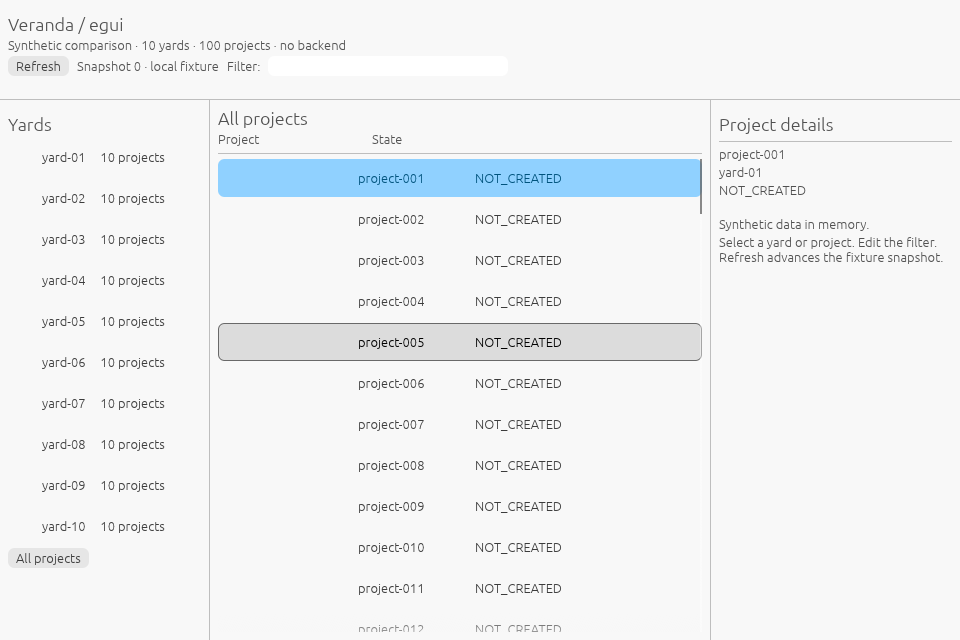 | 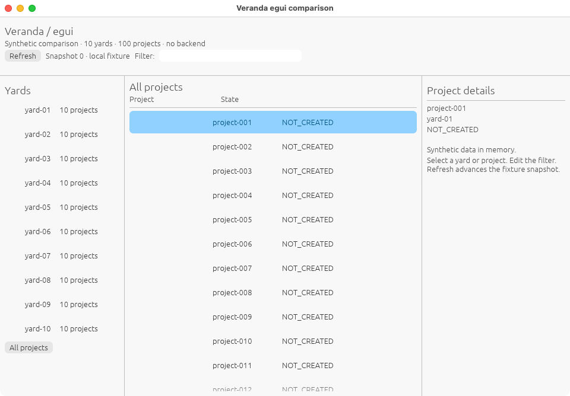 | 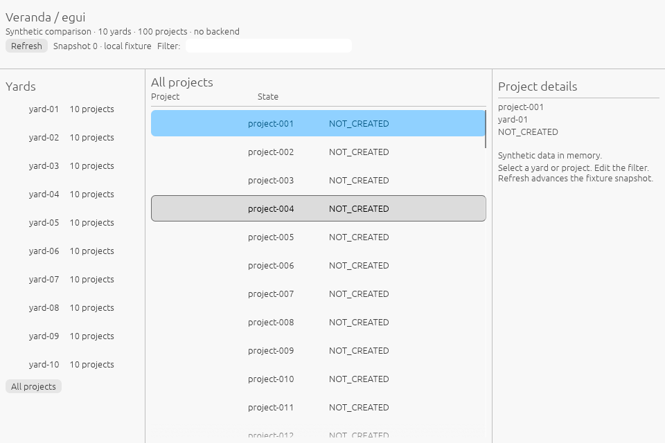 |
| GTK4 (C) |  | 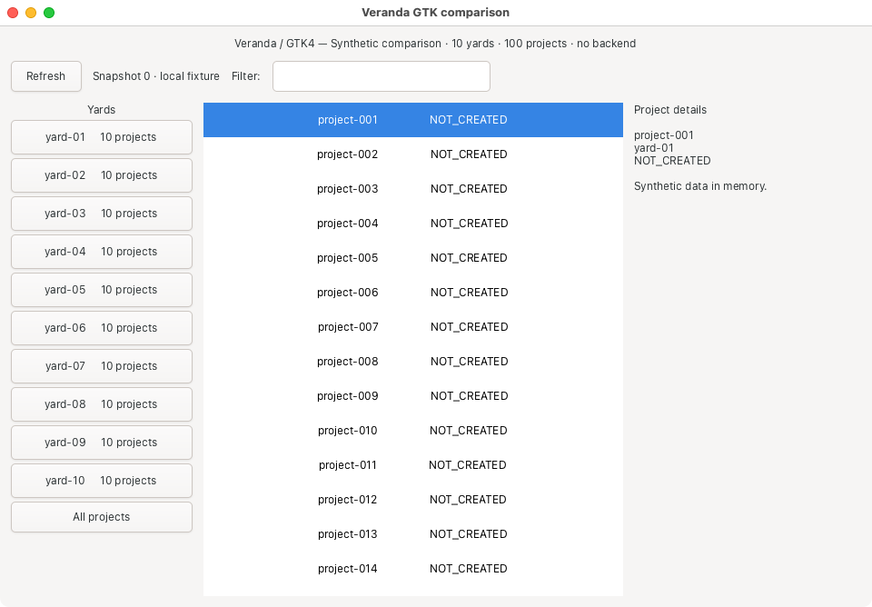 | 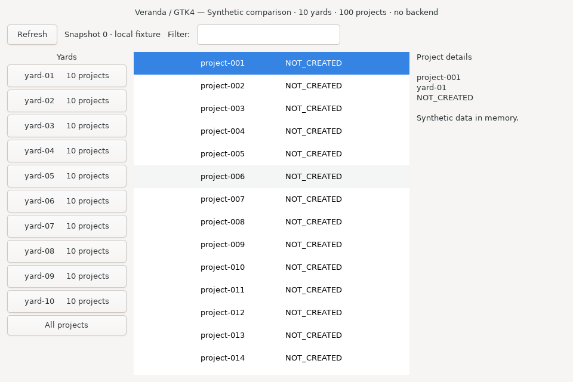 |
| Slint | 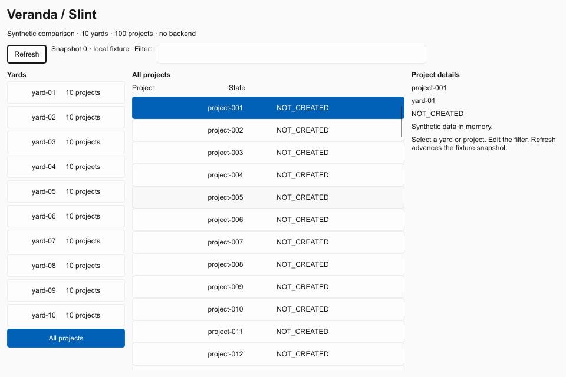 |  | 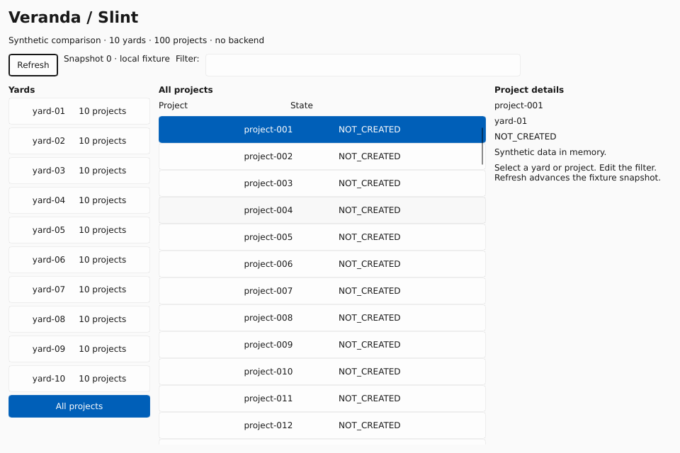 |
| Qt Widgets |  |  | 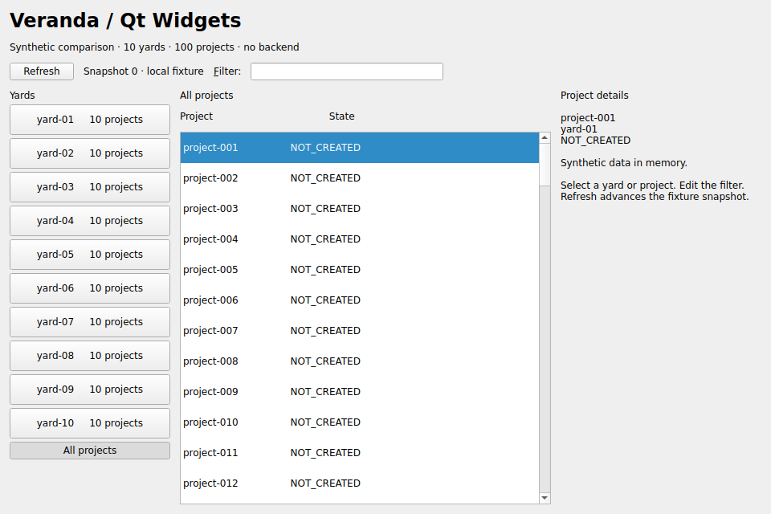 |
| Tauri | 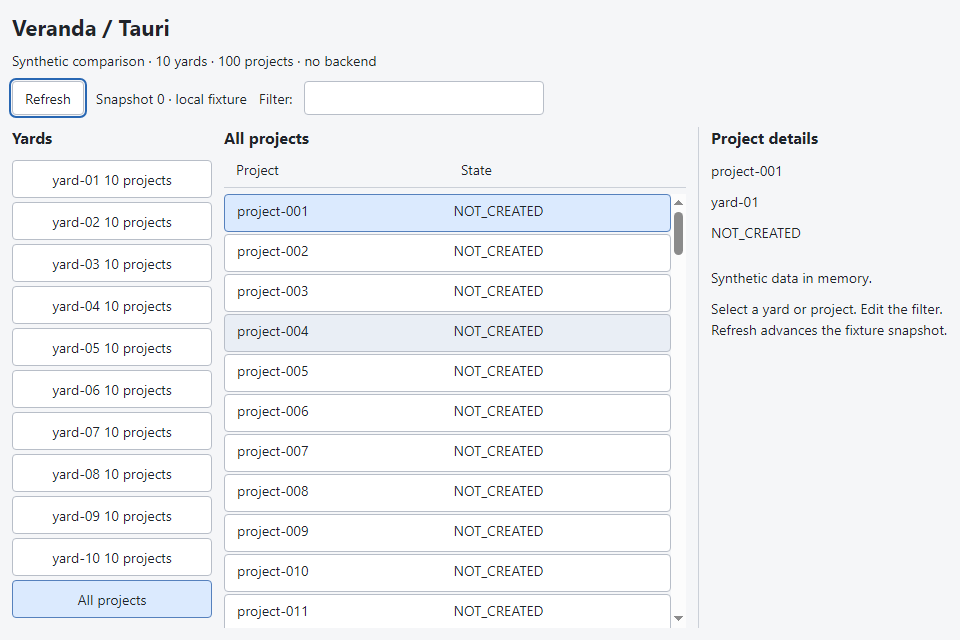 | 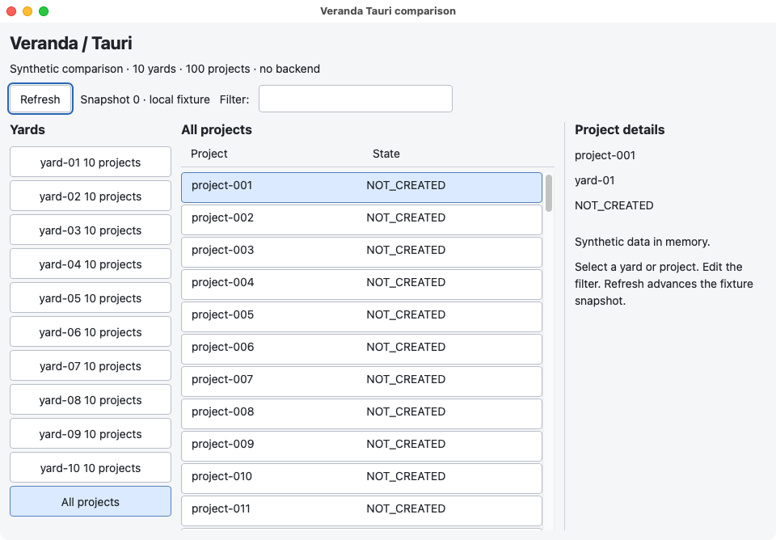 | 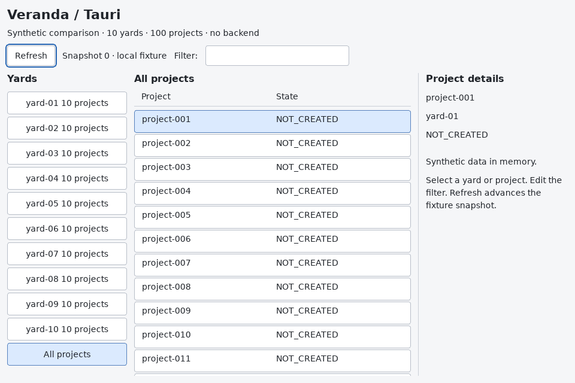 |

The [README layout examples](../README.md#what-the-layout-code-looks-like) show the
widget/declarative/HTML approaches; links there lead to the complete runnable code.
Refresh receives initial focus in GTK, Slint, Qt and Tauri to avoid a focused filter
caret workload. Egui's initial filter has no keyboard focus.

## Layout code

| Framework | Layout in these examples | State and events |
| --- | --- | --- |
| egui/eframe | Rust panel/widget calls inside `App::ui` | Rust fields; widget responses update state |
| GTK4 | C code builds persistent `GtkBox`/`GtkListBox` widgets | GTK signals call C callbacks |
| Slint | Declarative `.slint` boxes, properties and repeated rows | Rust models and callbacks update properties |
| Qt Widgets | C++ builds `QWidget`, `QVBoxLayout` and `QHBoxLayout` objects | Qt signals connect to C++ lambdas |
| Tauri | HTML panels, CSS Grid and persistent DOM buttons | JavaScript event handlers; Rust starts the system webview |

Egui declares panels and widgets inside `App::ui`; state updates sit beside click handling.
This example does not request continuous repainting. An excerpt from the
[complete Rust example](../examples/egui/src/main.rs):

```rust
egui::Panel::left("yards").exact_size(210.0).show(ui, |ui| {
    ui.heading("Yards");
    if ui.button("All projects").clicked() {
        self.yard = 0;
    }
});
egui::CentralPanel::default().show(ui, |ui| {
    ui.heading("All projects");
    egui::ScrollArea::vertical().show(ui, |ui| {
        // Project buttons update self.project when clicked.
    });
});
```

GTK constructs a persistent widget tree and connects signals to callbacks. The
[C control](../examples/gtk-c/main.c) uses this layout shape:

```c
GtkWidget *body = gtk_box_new(GTK_ORIENTATION_HORIZONTAL, 12);
GtkWidget *yards = gtk_box_new(GTK_ORIENTATION_VERTICAL, 4);
GtkWidget *scroll = gtk_scrolled_window_new();
projects = gtk_list_box_new();
gtk_widget_set_hexpand(scroll, TRUE);
gtk_scrolled_window_set_child(GTK_SCROLLED_WINDOW(scroll), projects);
gtk_box_append(GTK_BOX(body), yards);
gtk_box_append(GTK_BOX(body), scroll);
g_signal_connect(projects, "row-selected", G_CALLBACK(select_project), NULL);
```

These are shortened layout excerpts. The linked files contain the runnable applications.
The GTK control is written in C; these numbers do not measure Rust GTK bindings.

### Slint: declarative widgets and Rust callbacks

The [layout](../examples/slint/ui/main.slint) declares widgets and exposes callbacks;
[Rust](../examples/slint/src/main.rs) supplies the filtered model and updates properties:

```slint
ListView {
    for project in root.projects: Button {
        text: project.name + "                 NOT_CREATED";
        height: 38px;
        checkable: true;
        checked: root.selected-project == project.id;
        clicked => { root.choose-project(project.id); }
    }
}
```

This stock Slint example explicitly selects winit/software and enables accessibility.
It does not import the four correctness forks used by the old Slint prototype.

### Qt Widgets: persistent C++ widgets and signals

The [C++ example](../examples/qt/main.cpp) creates a widget tree and connects signals:

```cpp
auto *root = new QVBoxLayout(&window);
auto *body = new QHBoxLayout;
body->setSpacing(12);
auto *yards = new QWidget;
yards->setFixedWidth(200);
body->addWidget(yards);
auto *projectLayout = new QVBoxLayout;
auto *projects = new QListWidget;
projectLayout->addWidget(projects);
body->addLayout(projectLayout, 1);  // Expand the center column.
auto *details = new QLabel;
details->setFixedWidth(250);
body->addWidget(details);
root->addLayout(body, 1);
```

Qt Widgets uses native widget/layout APIs here; QML, Qt Quick and WebEngine are absent.

### Tauri: a web layout in a native system webview

The [HTML](../examples/tauri/frontend/index.html) and
[CSS](../examples/tauri/frontend/style.css) define the panels; ordinary DOM event handlers
in [JavaScript](../examples/tauri/frontend/main.js) update the in-memory fixture:

```css
main {
    display: grid;
    grid-template-columns: 200px minmax(0, 1fr) 250px;
    gap: 12px;
}
```

```javascript
filter.addEventListener("input", updateFilter);
document.getElementById("all-projects").addEventListener("click", () => selectYard(0));
document.getElementById("refresh").addEventListener("click", () => {
  state.refreshes += 1;
  document.getElementById("snapshot").textContent = `Snapshot ${state.refreshes} · local fixture`;
});
```

There is no frontend framework, development server or application backend. Tauri uses
different system webviews on each OS, so a Windows result is not a WebKitGTK result.
See [Tauri's webview documentation](https://v2.tauri.app/reference/webview-versions/).


## Environment and process evidence

Rust pins are egui/eframe **0.37.0**, Slint **1.18.1**, and Tauri **2.12.5**.
All Rust builds recorded Rust **1.99.1**. Native libraries differ by OS:

| Component | Linux | Windows | macOS |
| --- | --- | --- | --- |
| GTK4 C control | 4.14.5 | 4.24.1, MSYS2 UCRT64 | 4.24.1 |
| Qt Widgets | 6.4.2 | MSVC kit 6.8.3 | Homebrew qtbase 6.12.0_2 |
| Tauri system engine | WebKitGTK 2.52.6, GTK3/API4.1 | Installed WebView2 131.0.2903.86 | System WebKit 20621.3.11.11.3 |

Egui's actual Linux context reported **llvmpipe (LLVM 20.1.2, 256 bits)** with Mesa 25.2.8;
macOS reported **Apple Software Renderer**; Windows reported **Microsoft Basic Render
Driver**, DX12, device type CPU, driver 10.0.20348.5756, FXC. These are hosted software
graphics configurations. GTK/Qt/WebKit internal renderers were not instrumented.

### windows-2022

Base-run environment: Windows-2022Server-10.0.20348-SP0; `AMD64`, 4 logical CPUs, 15.99 GiB RAM. Runner image `20261101.353.1`. Framework names below link to each actual raw outcome, including its source commit and run ID.

| Framework | CPU seconds | Actual elapsed, s | RSS/Working Set p95, MiB | Observed maximum, MiB | Observed process identities |
| --- | ---: | ---: | ---: | ---: | ---: |
| [egui / eframe](../measurements/native-42420765503/windows-2022/egui/outcome.json) | 0.000000 | 122.28 | 51.87 | 51.87 | 1 |
| [GTK4 (C)](../measurements/native-42425371788/windows-2022/gtk/outcome.json) | 0.000000 | 124.08 | 75.54 | 75.54 | 2 |
| [Slint](../measurements/native-42425371788/windows-2022/slint/outcome.json) | 0.000000 | 122.45 | 21.64 | 21.64 | 1 |
| [Qt Widgets](../measurements/native-42420765503/windows-2022/qt/outcome.json) | 0.000000 | 122.25 | 32.02 | 32.02 | 1 |
| [Tauri](../measurements/native-42420765503/windows-2022/tauri/outcome.json) | 0.140625 | 131.38 | 273.94 | 274.55 | 10 |

### macos-15

Base-run environment: macOS-15.8.2-arm64-arm-64bit; `arm64`, 3 logical CPUs, 7.00 GiB RAM. Runner image `20261104.0514.1`. Apple M1 (Virtual). Framework names below link to each actual raw outcome, including its source commit and run ID.

| Framework | CPU seconds | Actual elapsed, s | RSS/Working Set p95, MiB | Observed maximum, MiB | Observed process identities |
| --- | ---: | ---: | ---: | ---: | ---: |
| [egui / eframe](../measurements/native-42423222092/macos-15/egui/outcome.json) | 0.000792 | 167.95 | 77.94 | 77.94 | 1 |
| [GTK4 (C)](../measurements/native-42423222092/macos-15/gtk/outcome.json) | 0.000925 | 178.32 | 119.56 | 119.56 | 1 |
| [Slint](../measurements/native-42423222092/macos-15/slint/outcome.json) | 0.000000 | 178.32 | 67.58 | 67.58 | 1 |
| [Qt Widgets](../measurements/native-42423222092/macos-15/qt/outcome.json) | 0.000413 | 178.52 | 88.70 | 88.70 | 1 |
| [Tauri](../measurements/native-42426792323/macos-15/tauri/outcome.json) | 0.030260 | 176.70 | 134.92 | 134.94 | 3 |

### ubuntu-24.04

Base-run environment: Linux-7.0.0-1017-azure-x86_64-with-glibc2.39; `x86_64`, 4 logical CPUs, 15.61 GiB RAM. Runner image `20261101.360.1`. Framework names below link to each actual raw outcome, including its source commit and run ID.

| Framework | CPU seconds | Actual elapsed, s | RSS/Working Set p95, MiB | Observed maximum, MiB | Observed process identities |
| --- | ---: | ---: | ---: | ---: | ---: |
| [egui / eframe](../measurements/native-42420765503/ubuntu-24.04/egui/outcome.json) | 0.020000 | 121.60 | 120.71 | 120.71 | 1 |
| [GTK4 (C)](../measurements/native-42420765503/ubuntu-24.04/gtk/outcome.json) | 0.000000 | 121.58 | 240.27 | 240.27 | 1 |
| [Slint](../measurements/native-42420765503/ubuntu-24.04/slint/outcome.json) | 0.020000 | 121.61 | 22.99 | 22.99 | 1 |
| [Qt Widgets](../measurements/native-42420765503/ubuntu-24.04/qt/outcome.json) | 0.000000 | 121.66 | 33.60 | 33.60 | 1 |
| [Tauri](../measurements/native-42420765503/ubuntu-24.04/tauri/outcome.json) | 0.030000 | 123.59 | 499.23 | 499.23 | 3 |

Egui uses Glow on Linux/macOS and WGPU/DX12 with FXC on Windows; its application
log reports the actual renderer/adapter. Slint explicitly selects winit/software.
Windows GTK requests Cairo and native decorations (`GTK_CSD=0`) with its MSYS2 UCRT64 runtime; other GTK jobs use the
platform default. Qt uses Widgets rather than Qt Quick or WebEngine. Tauri uses
WebKitGTK on Linux, WebView2 on Windows and WKWebView on macOS. Installed native
versions and all candidate application logs are retained with the raw data.

macOS Tauri includes application-owned WebKit XPC helpers discovered through
verified process responsibility, beyond ordinary parent/child ancestry. Each helper's
PID, creation time, responsible PID and available coalition metadata are retained in
`tauri/outcome.json`. Coalition equality alone is never used as ownership proof.
The app is verified as its own responsible process, attributable WebContent is
required, and unassigned new WebKit helpers/access errors refuse a complete result.
Unknown helper lookup failures are retried. Unresolved live helpers and access
errors for already attributed app helpers refuse completion; verified unrelated
owners are excluded. Helpers disappearing before attribution are logged as polling
races rather than silently allocated. This private macOS API is validated on the
recorded run, not guaranteed for future images.

Windows Tauri has seven stable sampled processes. Its faster discovery also saw
three transient helpers that never appeared in a one-second CPU/RSS read; their
CPU work is not included. Reported CPU is an observed counter sum, not exhaustive
process-lifetime accounting. The Windows GTK/Slint and macOS Tauri focused retries use fresh VMs
of the same runner labels; each row retains its actual image, source and run ID.

Shared system services are excluded. Ancestry polling (5 Hz) and responsibility
polling (at most 1 Hz) can miss short-lived processes; an exiting process's final CPU
fraction can be missed. A process predating the CPU baseline discovered late refuses
a complete measurement rather than charging its startup CPU to idle. These limits
are recorded in the [probe procedure](github-runners.md).

## Linux minimized state

Linux additionally verifies `_NET_WM_STATE_HIDDEN` and `IsUnMapped`, settles for
30 seconds, samples another 120 intervals, then verifies that state again.

| Framework | Median family RSS, MiB | CPU, % one core | CPU seconds | Actual elapsed, s |
| --- | ---: | ---: | ---: | ---: |
| egui / eframe | 120.71 | 0 recorded | 0.000000 | 121.65 |
| GTK4 (C) | 240.27 | 0 recorded | 0.000000 | 121.69 |
| Slint | 22.99 | 0 recorded | 0.000000 | 121.57 |
| Qt Widgets | 33.60 | 0 recorded | 0.000000 | 121.62 |
| Tauri | 489.77 | 0.00809 | 0.010000 | 123.60 |

Earlier attempts and their incomplete scopes/clipped captures remain in the [historical native observations](native-results.md).
