# Native memory, CPU and appearance comparison

GitHub Actions run [42538198685](https://github.com/HeyVasily/rust-desktop-comparison/actions/runs/42538198685)
(source commit `f378db0`), measured 2026-11-09. Five release examples — egui/eframe,
**gtk4-rs**, Slint, Qt Widgets and Tauri — were measured on Windows Server 2022,
macOS 15 (ARM64) and Ubuntu 24.04, **five times each, every repetition on a fresh
runner VM**. All 75 visible comparisons and all 25 Linux minimized phases passed
their window, process-scope, sampling and cleanup checks.

The workload is a quiet initial interface: 10 synthetic yards, 100 projects,
project-001 selected, empty filter and snapshot 0, no backend or periodic work.
The visible content is **960×640 logical pixels**. Each phase settles for 30 s,
then records 120 intervals. Values below are the **median of the five repetition
medians**, with the lowest and highest repetition in brackets.

Data: [summary.csv](../measurements/native-matrix-2026-11-09/summary.csv) (aggregates),
[runs.csv](../measurements/native-matrix-2026-11-09/runs.csv) (one row per repetition),
raw outcomes and gzipped samples under
[measurements/native-42538198685](../measurements/native-42538198685/).
The [previous single-run matrix](native-matrix-2026-11-07.md) measured the GTK C control.

## Memory

The primary metric counts shared pages proportionally or not at all, so it matches
what each OS's own monitor shows:

- **Linux PSS** — shared pages divided among the processes that map them.
- **macOS physical footprint** (`phys_footprint`) — Activity Monitor's *Memory*.
- **Windows private working set** — Task Manager's *Memory*.

Values are summed over the application's process family, including webview helpers.
Compare toolkits within a column; each OS defines its metric differently.

| Framework | Linux PSS, MiB | Windows private WS, MiB | macOS footprint, MiB |
| --- | ---: | ---: | ---: |
| egui / eframe | 96.40 [95.94–96.61] | 26.87 [26.25–29.41] | 28.22 [27.31–30.56] |
| GTK4 (gtk4-rs) | 211.74 [211.48–212.03] | 33.23 [32.97–33.38] | 43.69 [35.95–46.13] |
| Slint | **17.45** [17.39–17.71] | **9.03** [9.00–9.12] | **17.13** [16.94–17.16] |
| Qt Widgets | 22.96 [22.86–22.99] | 15.03 [14.98–15.17] | 24.22 [24.14–24.47] |
| Tauri | 338.18 [337.06–340.10] | 116.15 [115.91–116.38] | 40.77 [40.40–41.05] |

The conventional metric, summed RSS / Working Set, counts every shared page in full
in every process. It is kept for continuity with the earlier series:

| Framework | Linux RSS, MiB | Windows Working Set, MiB | macOS RSS, MiB |
| --- | ---: | ---: | ---: |
| egui / eframe | 120.46 | 51.69 | 77.41 |
| GTK4 (gtk4-rs) | 240.56 | 76.02 | 117.33 |
| Slint | 22.68 | 21.63 | 69.98 |
| Qt Widgets | 33.46 | 31.62 | 88.98 |
| Tauri | 501.50 | 268.85 | 134.58 |

### Repeatability and outliers

A repetition is flagged when its median differs from the median of all five by more
than 10 %. Twelve of fifteen visible cases varied by less than 2 % between VMs.

- **GTK on macOS** is bimodal: repetitions 2 and 4 used 36.0–36.6 MiB, the other
  three 43.7–46.1 MiB, while their RSS moved the other way (127 and 120 MiB). The
  median includes all five; the cause was not isolated.
- **egui** on Windows and macOS spread 11–12 %: one or two repetitions were 2–3 MiB
  higher. Its Linux spread was 0.7 %.

Linux minimized phases matched the visible phase for every toolkit except Tauri
(331.12 MiB PSS minimized vs 338.18 visible).

### Why Linux is higher

Linux used Xvfb with Mesa llvmpipe software OpenGL. GTK 4.14 and egui render through
OpenGL there, and llvmpipe's private allocations count in PSS. The GTK renderer was
not pinned or observed, so the 212 MiB does not isolate a GTK cost. Tauri runs
several WebKitGTK processes; PSS removes their double-counted shared libraries
(501 → 338 MiB) but keeps each process's private memory. Slint (software renderer)
and Qt avoid the GL stack in these runs.

## CPU

Idle CPU, percent of one logical core, median of five repetitions (highest repetition
in brackets). Every value is below 0.11 %; this is not a performance ranking.

| Framework | Linux | Windows | macOS |
| --- | ---: | ---: | ---: |
| egui / eframe | 0.0081 [0.0081] | 0 recorded | 0.0041 [0.0050] |
| GTK4 (gtk4-rs) | 0 recorded | 0 recorded | 0.0012 [0.0053] |
| Slint | 0.0082 [0.0162] | 0 recorded | 0.0004 [0.0046] |
| Qt Widgets | 0 recorded | 0 recorded | 0.0002 [0.0010] |
| Tauri | 0.0231 [0.0386] | 0.0819 [0.1089] | 0.0168 [0.0376] |

`0 recorded` means no CPU-counter increment in any repetition, not zero work.

## Executable size

Release executables; the Rust examples use `strip = true` and Qt is stripped on
Linux/macOS. Shared runtimes are **not** included: GTK and Qt load system or bundled
libraries (the Windows Qt deploy directory is 49.2 MiB), and Tauri uses the system
webview.

| Framework | Linux | Windows | macOS |
| --- | ---: | ---: | ---: |
| egui / eframe | 12.0 MiB | 12.8 MiB | 5.4 MiB |
| GTK4 (gtk4-rs) | 0.39 MiB | 2.1 MiB | 0.38 MiB |
| Slint | 19.6 MiB | 12.8 MiB | 11.7 MiB |
| Qt Widgets | 0.03 MiB | 0.05 MiB | 0.07 MiB |
| Tauri | 6.6 MiB | 8.2 MiB | 6.3 MiB |

## System dark mode

After the measurements, the first repetition on each OS switched the system to dark
mode and relaunched every example without code changes:

- **Windows**: `AppsUseLightTheme=0` and `SystemUsesLightTheme=0` in the registry.
- **macOS**: global `AppleInterfaceStyle=Dark`.
- **Linux**: `org.gnome.desktop.interface color-scheme 'prefer-dark'`, verified
  through the Settings portal (`org.freedesktop.appearance color-scheme = 1`).

A capture counts as dark when its mean client luminance dropped below 110/255 and by
more than 60 from the light capture; every capture was also inspected.

| Framework | Windows | macOS | Linux |
| --- | :---: | :---: | :---: |
| egui / eframe | ✅ dark | ✅ dark | ❌ light |
| GTK4 (gtk4-rs) | ❌ light | ❌ light (dark titlebar only) | ❌ light |
| Slint | ✅ dark | ✅ dark | ✅ dark |
| Qt Widgets | ❌ light | ✅ dark | ❌ light |
| Tauri | ✅ dark | ✅ dark | ✅ dark |

The egui example uses eframe's default `ThemePreference::System` with a light
fallback; Tauri's CSS defines both palettes through `prefers-color-scheme`, because a
web UI must style dark mode itself. Qt on Windows used the Windows Server 2022 style
with Qt 6.8.3; Linux Qt 6.4 predates `QStyleHints::colorScheme`.

| Framework | Windows | macOS | Linux |
| --- | --- | --- | --- |
| egui / eframe | 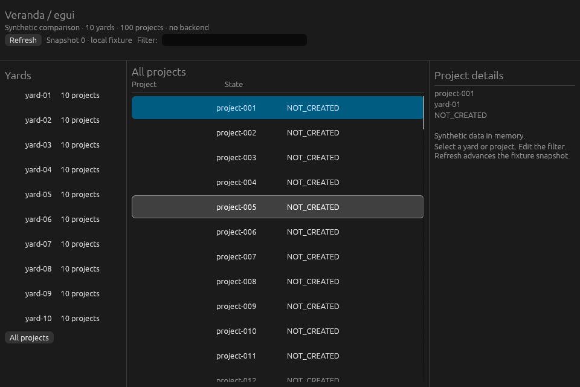 | 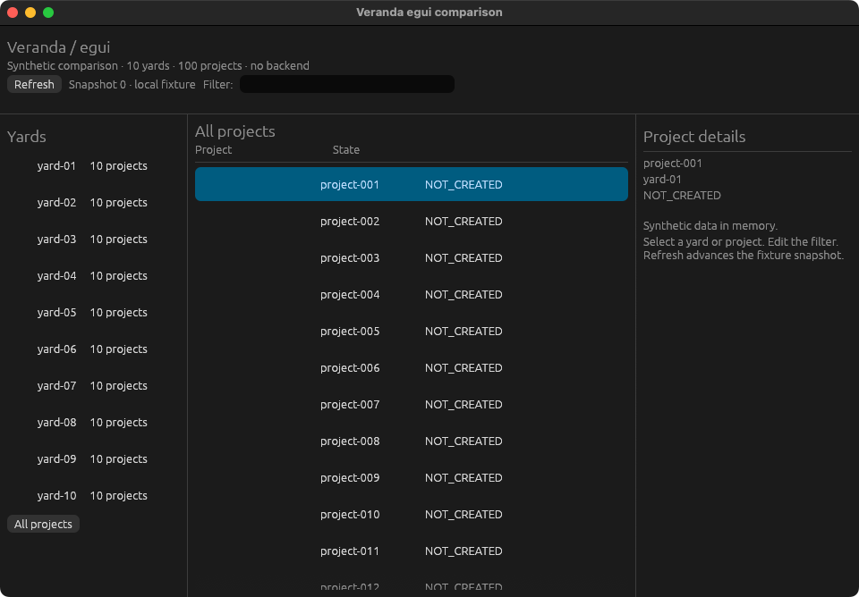 |  |
| GTK4 (gtk4-rs) | 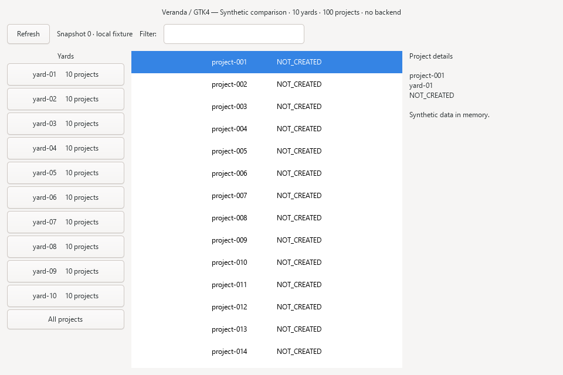 | 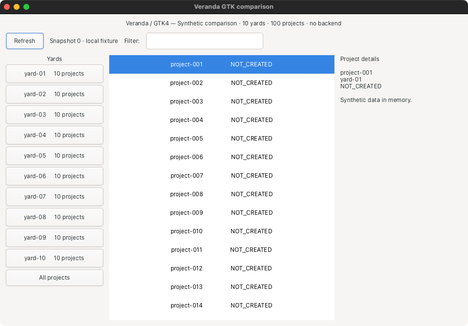 |  |
| Slint | 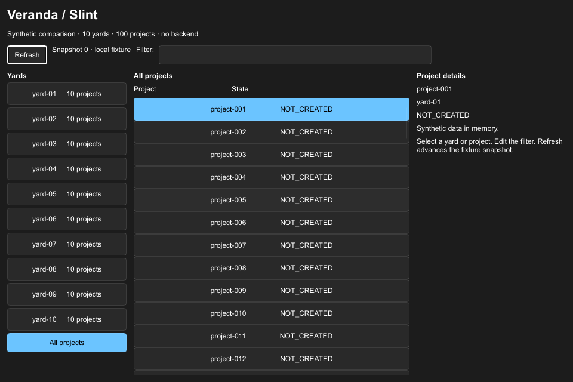 | 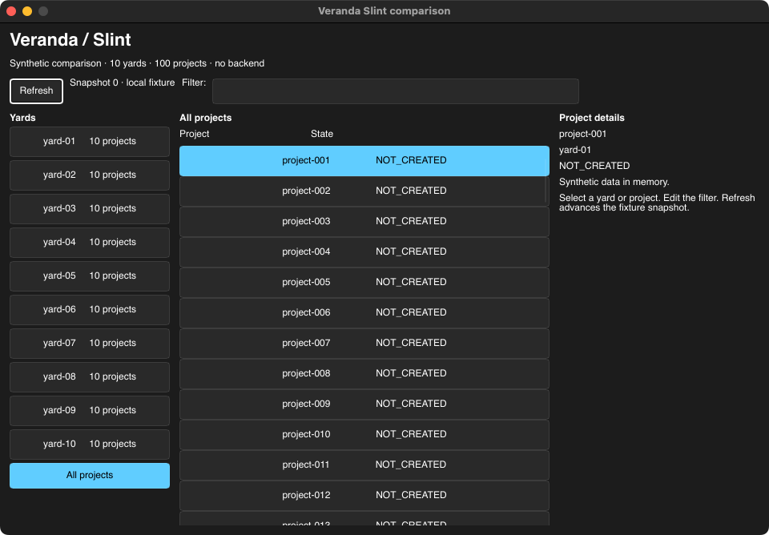 |  |
| Qt Widgets | 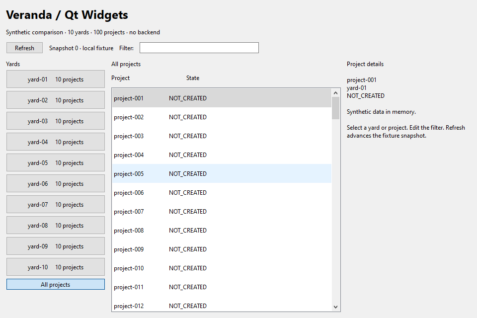 | 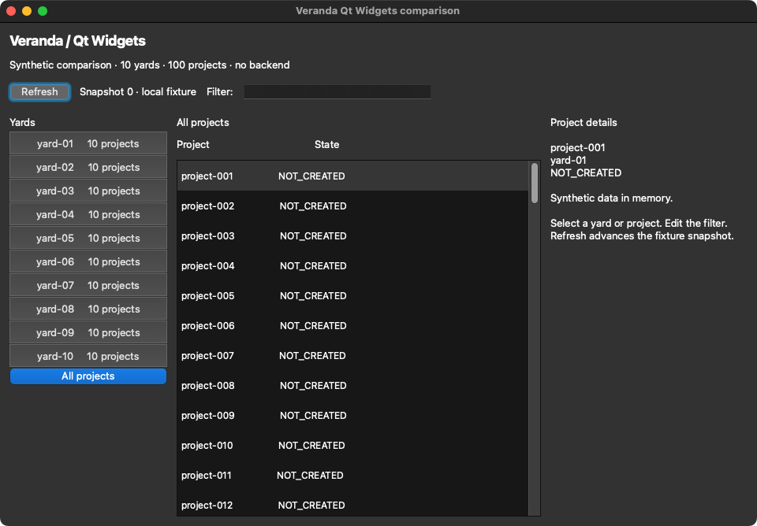 | 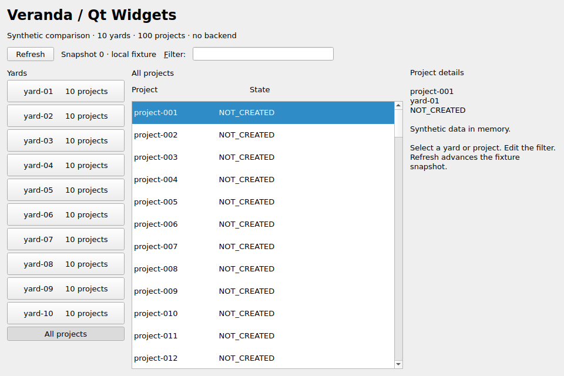 |
| Tauri | 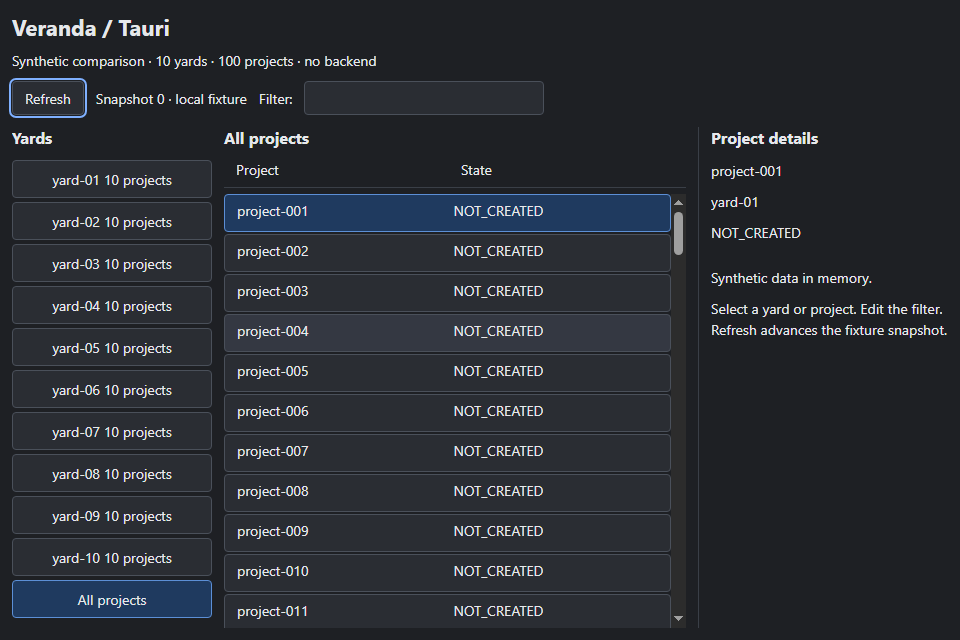 | 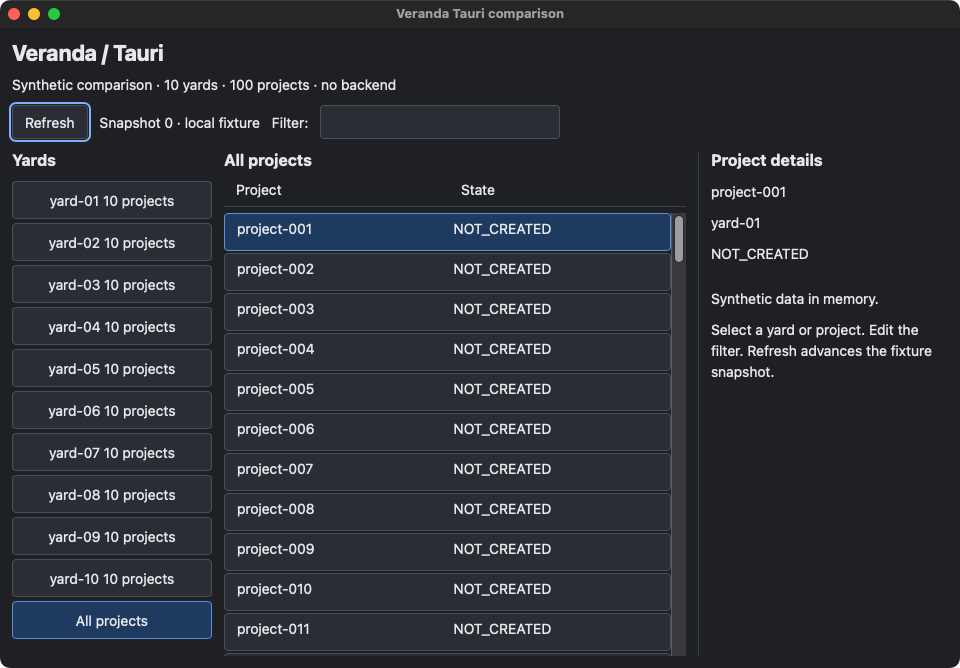 | 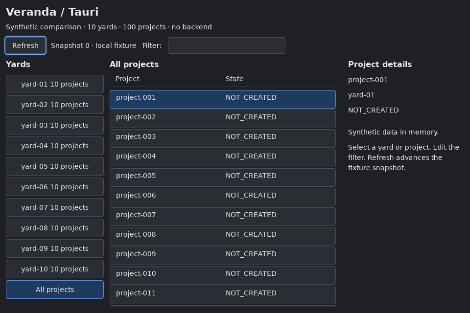 |

## Interfaces captured during measurement

Settled comparison captures from repetition 1 in light mode. macOS captures include
the native titlebar; Windows/Linux captures cover the client area.

| Framework | Windows | macOS | Linux |
| --- | --- | --- | --- |
| egui / eframe |  |  |  |
| GTK4 (gtk4-rs) | 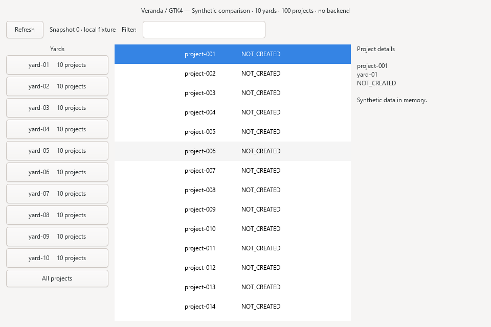 |  |  |
| Slint |  | 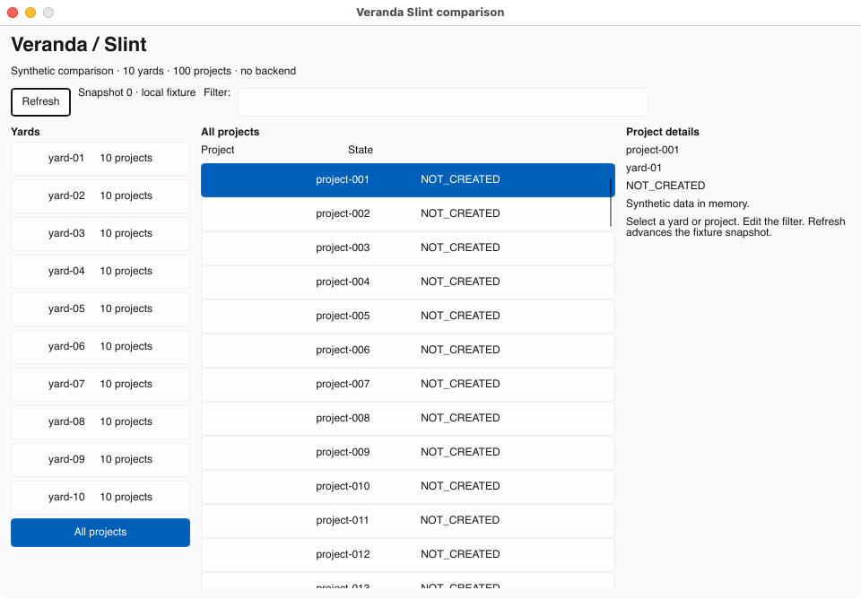 |  |
| Qt Widgets |  | 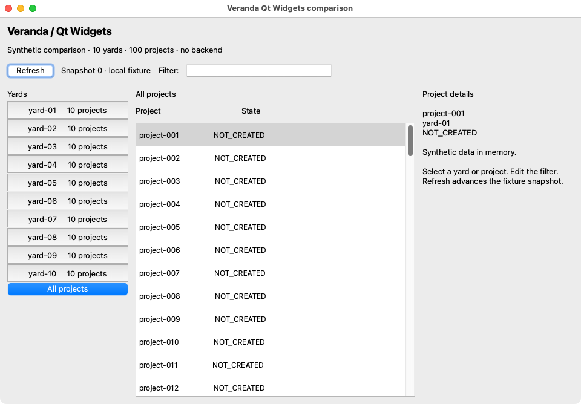 |  |
| Tauri |  |  |  |

## Versions and environment

| Component | Linux (ubuntu-24.04) | Windows (windows-2022) | macOS (macos-15, ARM64) |
| --- | --- | --- | --- |
| Runner image | 20261101.360.1 | 20261101.353.1 | 20261104.0514.1 |
| egui / eframe 0.37.0 | Glow, llvmpipe | wgpu DX12, Basic Render Driver | Glow, Apple Software Renderer |
| gtk4-rs 0.11.5 | GTK 4.14.5 (Ubuntu) | GTK 4.24.1, MSYS2 UCRT64, Cairo, native decorations | GTK 4.24.1 (Homebrew) |
| Slint 1.18.1 | winit, software renderer | winit, software renderer | winit, software renderer |
| Qt Widgets | 6.4.2 (Ubuntu) | 6.8.3 MSVC | 6.12.0 (Homebrew qtbase) |
| Tauri 2.12.5 | WebKitGTK 2.52.6 | WebView2 131.0.2903.86 | WKWebView (system) |

Linux ran under Xvfb with Openbox and `LIBGL_ALWAYS_SOFTWARE=1`. Probe procedure,
window checks and process-scope rules are in the [runner guide](github-runners.md).

## Limits

- Idle, UI-only observations: no startup time, interaction, frame rate or GPU rendering.
- Runners, CPU architectures and toolkit builds differ between OSes; compare within an OS.
- Summed process metrics depend on which helpers belong to the app; macOS WebKit
  helpers are attributed through the responsibility scope described in the runner guide.
- Five repetitions expose VM-to-VM variation but are not a statistical population.
