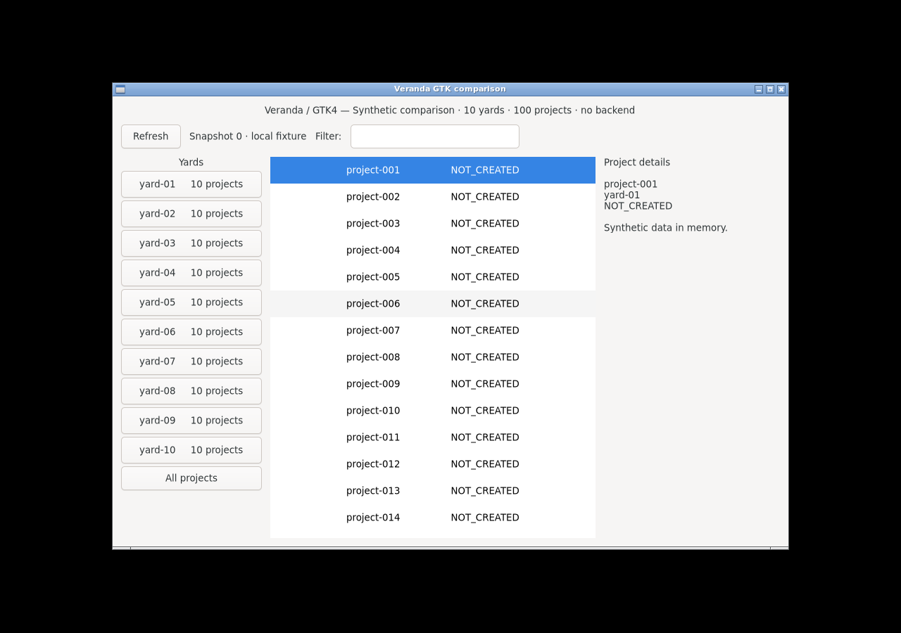

# GTK Linux memory: controlled renderer and display experiment

The large footprint is mostly the graphics path in this software-rendered test
setup. On a fresh Ubuntu 24.04 runner, the default renderer reproduced the earlier
240.27 MiB result closely: **238.36 MiB RSS with observed OpenGL, versus 97.87 MiB
with Cairo**, using one executable on the same runner.

**Selecting Cairo does not by itself prevent GTK's X11 backend from loading
Mesa/LLVM.** A second controlled experiment on Debian 13 used 119.45 MiB with
X11/Cairo and 31.68 MiB with the same Cairo renderer plus GL/Vulkan disabled.
Those two cases produced byte-identical screenshots. Wayland/Cairo used 33.07 MiB.

This follow-up preserves the [published native matrix](full-native-results.md)
and [historical comparison](historical-comparison.md). It tests the current C demo;
it does not recreate the unavailable historical frontend binary.

## Reproducing the Ubuntu runner footprint

[GitHub run 42472650761](https://github.com/HeyVasily/rust-desktop-comparison/actions/runs/42472650761)
used source `5096df7e82cd374a98772722f594abd4cfb05398`, one compiled C binary,
GTK/GDK `4.14.5+ds-0ubuntu0.10`, Mesa `25.2.8`, and LLVM `20.1` on Ubuntu 24.04.
It ran the same X11/Xvfb/Openbox setup twice, changing only `GSK_RENDERER` from
absent to `cairo` for the application measurement. The session bus and AT-SPI were
available in both cases. [Raw evidence and original PNGs](../measurements/gtk-memory-ab-2026-11-08/ubuntu-24.04/README.md)
retain the actual runtime classes and all samples.

| Requested renderer | Observed renderer | Median RSS, MiB | Median PSS, MiB | Threads |
| --- | --- | ---: | ---: | ---: |
| Default (variable absent) | `GskGLRenderer` | 238.36 | 209.67 | 14 |
| Cairo | `GskCairoRenderer` | 97.87 | 67.86 | 14 |

Switching to Cairo saved **140.49 MiB RSS**. The final heap mapping fell from
130.46 to 11.39 MiB; LLVM residency fell from 56.61 to 45.66 MiB, and Gallium from
11.55 to 8.96 MiB. Heap names do not reveal individual allocation owners, but the
same-run renderer intervention establishes the total effect. The remaining
Cairo footprint still includes substantial graphics-driver residency.

Both cases reported one process and a 960×640 mapped widget/surface at scale 1.
Each settled for 30 seconds and completed 120 intervals over 120.67–120.88 seconds.
RSS/PSS were constant across all 121 observations; statm RSS matched smaps RSS,
and omitting the baseline left the medians unchanged. CPU counters recorded no
increment, and swap was zero. The measurement step completed in 306 seconds;
the job completed successfully in 5 minutes 44 seconds. Every step passed.

The new default RSS is **1.90 MiB (0.79%) below** the original 240.27 MiB. This is a
close reproduction of the configuration's footprint, not proof of the original
unlogged renderer. The original run also lacked a working accessibility bus;
this follow-up corrects that confound within its paired cases. The original
sample files and headline result remain unchanged.

Renderer class names must be read together with their versions. In
[GTK 4.14.5](https://github.com/GNOME/gtk/blob/4.14.5/gsk/gskrenderer.c#L599-L668),
the software-GL path skips the new `ngl` choice and can select the legacy GL
renderer before Vulkan. In
[GTK 4.18.6](https://github.com/GNOME/gtk/blob/4.18.6/gsk/gskrenderer.c#L450-L493),
the old GL implementation has been removed and the new implementation uses the
`GskGLRenderer` name. The identical class string in these two experiments does
not mean identical renderer code. No cross-distribution version effect is
isolated here.

## One binary, one Debian VM

| Display | Requested renderer | Observed renderer | Median RSS, MiB | Median PSS, MiB | Threads |
| --- | --- | --- | ---: | ---: | ---: |
| X11 / Xvfb + Openbox | Default (variable absent) | `GskGLRenderer` | 216.90 | 187.82 | 14 |
| X11 / Xvfb + Openbox | Cairo | `GskCairoRenderer` | 119.45 | 90.49 | 14 |
| Wayland / headless labwc + Pixman | Default (variable absent) | `GskGLRenderer` | 199.32 | 187.28 | 15 |
| Wayland / headless labwc + Pixman | Cairo | `GskCairoRenderer` | 33.07 | 20.74 | 6 |
| X11 / Xvfb + Openbox | Cairo, `GDK_DISABLE=gl,vulkan` | `GskCairoRenderer` | 31.68 | 22.08 | 5 |

[Raw evidence](../measurements/gtk-memory-ab-2026-11-08/debian-13/README.md) includes
all samples, full `smaps`, grouped mappings, actual renderer logs and screenshots.
The fifth case was conditional: after the four core cases, the probe found
45.41 MiB of resident LLVM mappings in X11/Cairo and ran the targeted disable
control. It changed no application code, data, compositor, font package or window
size between those two X11/Cairo cases.

The guest had Debian 13, GTK/GDK `4.18.6+ds-2`, Mesa `25.0.7-2+deb13u1`, LLVM
`19.1.7`, labwc `0.8.3`, four logical CPUs and approximately 4 GiB RAM.
`LIBGL_ALWAYS_SOFTWARE=1` was held constant. Both default cases actually selected
OpenGL; the experiment does not assume that GTK defaults select the same renderer
on other versions or machines. Xvfb consistently logged failure to open the guest's
DRI device, consistent with the software-rendering setup; the application logs
were clean. The package metadata did not report an installed
Mesa Vulkan driver version, and no Vulkan ICD mapping was observed.

## What accounts for the difference

These are resident MiB from the final full `smaps` snapshot, grouped by backing
file or mapping name. They are components of RSS, not additional memory to add to
the headline RSS. Heap ownership is not inferred from a mapping name.

| Mapping | X11 default | X11 Cairo | Wayland Cairo | X11 Cairo, GL/Vulkan disabled |
| --- | ---: | ---: | ---: | ---: |
| LLVM library | 57.60 | 45.41 | 0 | 0 |
| Mesa Gallium library | 12.07 | 9.38 | 0 | 0 |
| `[heap]` | 104.12 | 33.52 | 3.02 | 5.29 |
| All anonymous resident pages, including heap and COW pages | 123.51 | 44.94 | 5.52 | 8.63 |

The anonymous row overlaps the other rows; it must not be summed with them.
The complete mapping tables retain private/shared clean/dirty accounting and PSS.

Two separate effects are measured:

1. **Default OpenGL to Cairo on X11 saves 97.45 MiB RSS.** The heap shrinks by
   70.60 MiB, with smaller LLVM/Gallium residency and other mapping changes.
   This shows the effect of the renderer selection for this binary and runtime;
   `smaps` alone cannot attribute individual heap allocations to GTK or Mesa.
2. **Preventing graphics initialization while keeping X11/Cairo saves another
   87.77 MiB RSS.** LLVM/Gallium mappings disappear and heap residency falls by
   28.23 MiB. Both cases still report `GskCairoRenderer`, and their screenshots
   are byte-identical. This isolates a large cost outside Cairo's actual drawing
   path. Wayland/Cairo avoids those driver mappings without the extra disable flag.

The actual X11/Cairo captures below are byte-identical, despite the memory change.
These are the original full-desktop PNGs, displayed smaller without altering them.

<table>
<tr><th>X11/Cairo: 119.45 MiB RSS</th><th>X11/Cairo, GL/Vulkan disabled: 31.68 MiB RSS</th></tr>
<tr>
<td></td>
<td></td>
</tr>
</table>

The second result agrees with the implementation: GTK 4.18.6's
[`gdk_x11_display_open()`](https://github.com/GNOME/gtk/blob/4.18.6/gdk/x11/gdkdisplay-x11.c#L1374-L1389)
calls `gdk_display_prepare_gl()` while opening the X11 display, before choosing
its compatible visuals. This happens independently of the later GSK renderer
selection. [GTK's documented diagnostic variables](https://docs.gtk.org/gtk4/running.html#environment-variables)
allow GL and Vulkan to be disabled. The experiment uses that control to test the
cause; it does not propose these debugging variables as general application policy.

## Measurement and visual controls

The [probe](../tools/gtk_memory_probe.py) launches a fresh display session and one
fresh application per case, with the same build, 10 yards, 100 projects, initial
selection, empty filter and snapshot 0. There is no backend, refresh polling or
input injection during sampling. AT-SPI and a session bus are installed and
available in every case; application logs have no accessibility warnings.

The C application emits one optional diagnostic after its first paint, reading
[`gtk_native_get_renderer()`](https://docs.gtk.org/gtk4/method.Native.get_renderer.html)
and the existing display/surface. It neither creates a GL context for inspection
nor runs a recurring diagnostic timer. It records GTK's runtime version (GTK and
GDK ship together), display type, renderer type, mapping state and dimensions.
Every case reported a 960×640 widget and surface, at scale 1. Wayland cases report
`GdkWaylandDisplay`, establishing native Wayland for the application. The archived
`WLR_XWAYLAND=0` setting is a binary-path override, not a supported off switch;
it does not independently establish that Xwayland was disabled.

Each case settles for 30 seconds, then records a baseline and **120 one-second
intervals**, giving 121 observations over 120.56–120.85 seconds. Headline RSS and
PSS are medians from `smaps_rollup`, summed over the observed app family. Every
case had one application process; desktop servers, session/accessibility buses and
the probe are excluded. RSS counts shared resident pages in full, while PSS
apportions them among their current mappers. Consequently display-server sharing
also affects the RSS/PSS difference.

The probe also retains psutil/statm RSS for comparison with the earlier runner
probe. In this Debian run its median equals the smaps RSS median in every case.
The original matrix uses 120 post-baseline observations; this follow-up's summary
includes its baseline. Excluding that baseline leaves all reported Debian medians
unchanged. The three cases with resident LLVM gained RSS during the first 10–44
seconds of sampling before reaching their final plateaus; Wayland/Cairo and
X11/Cairo with GL/Vulkan disabled were flat throughout. These are bounded idle
medians, not claims that every allocation had settled at the initial snapshot. All app CPU counters showed **0 recorded increment** during
sampling, not proof of zero CPU work. CPU percentage uses elapsed time and one
logical core. No sample reported swap.

Start/end full-desktop PNGs are byte-identical within each case and were visually
checked for the complete initial UI. X11 Cairo is also byte-identical with and
without the disable control. X11 and Wayland differ in desktop decoration and
font presentation; they are not claimed to have identical pixels or separately
verified child viewport geometry. The cleanest causal comparison is therefore
the same-backend X11/Cairo disable control.

The guest's setup, build, checks and five cases completed successfully in 794
seconds. The controller recorded allocation in 50 seconds and release/cleanup in
4 seconds, with native exit 0. The full launch-to-observed-completion duration was
approximately 848 seconds.

## What this establishes about the earlier numbers

The imported Debian X11/Cairo demo measured **120.75 MiB RSS**. The same rendering
configuration now gives **119.45 MiB**, while Wayland/Cairo gives **33.07 MiB**.
Thus a large X11-versus-Wayland gap can arise from driver initialization even when
both applications use Cairo. It does not require a language-binding explanation,
a hidden Go backend or an increased project count.

The historical **41.98 MiB** GUI was a different backend-connected C frontend,
with a larger window. Its source bundles are unavailable for a controlled rerun.
The difference between that 41.98 MiB and this 33.07 MiB remains unassigned; this
experiment does not prove the historical frontend's exact allocation breakdown.
The Ubuntu A/B closely reproduces the **240.27 MiB** configuration and isolates a
140.49 MiB renderer-selection effect in its own paired run. The Debian controls
independently isolate an 87.77 MiB X11/Cairo graphics-initialization effect.
Those deltas belong to different runtimes and must not be added together as an
exact decomposition of the historical 240.27-to-41.98 MiB difference. Nor do they
establish a GTK version regression or the cost of gtk4-rs, which was not tested.
