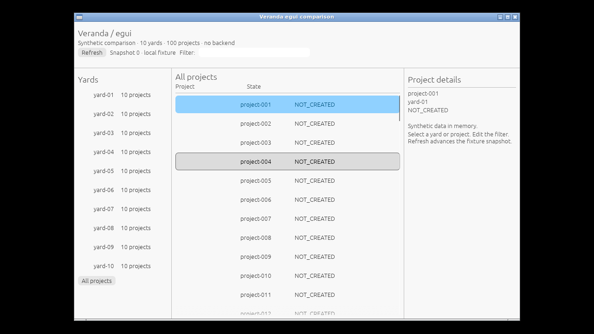
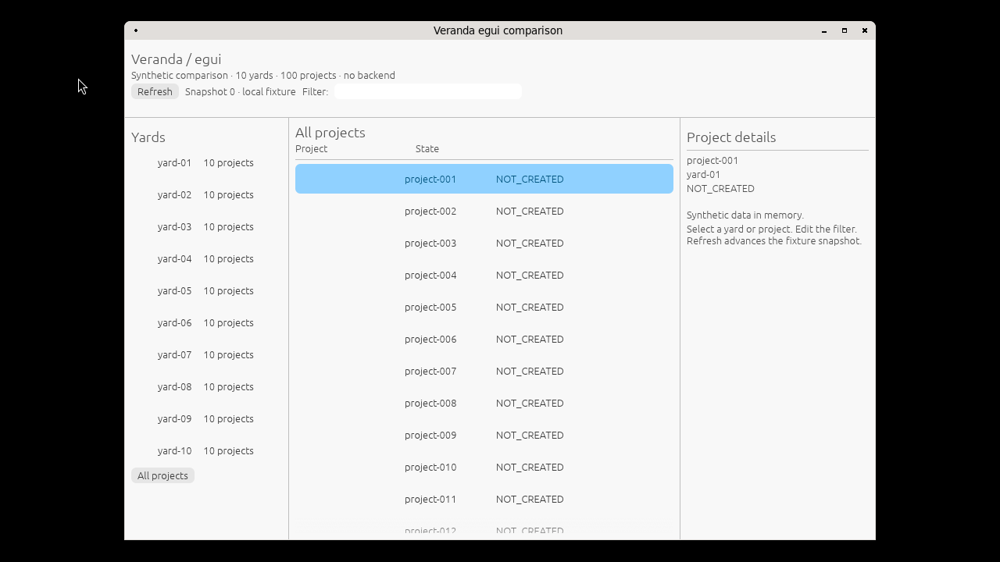
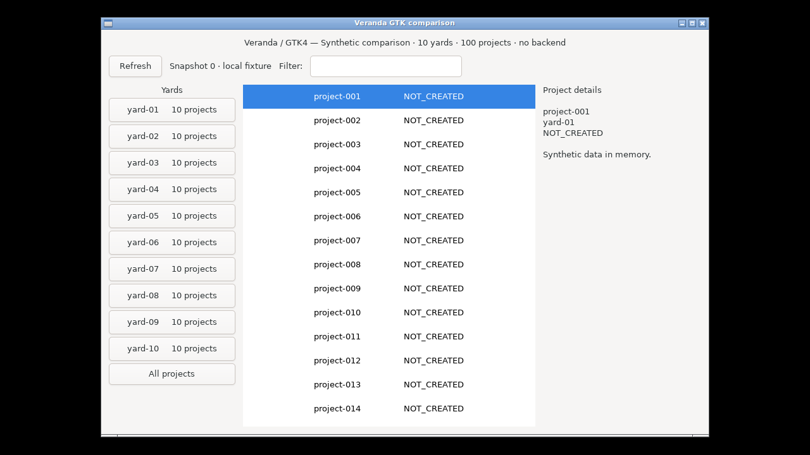
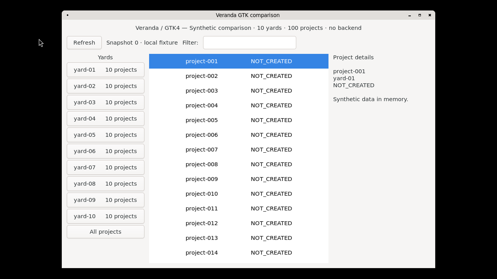
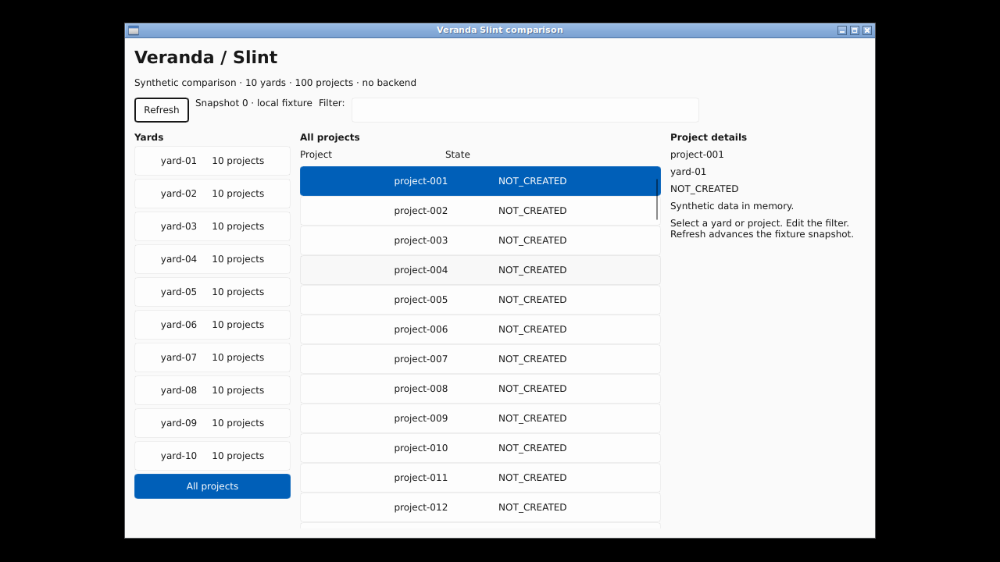
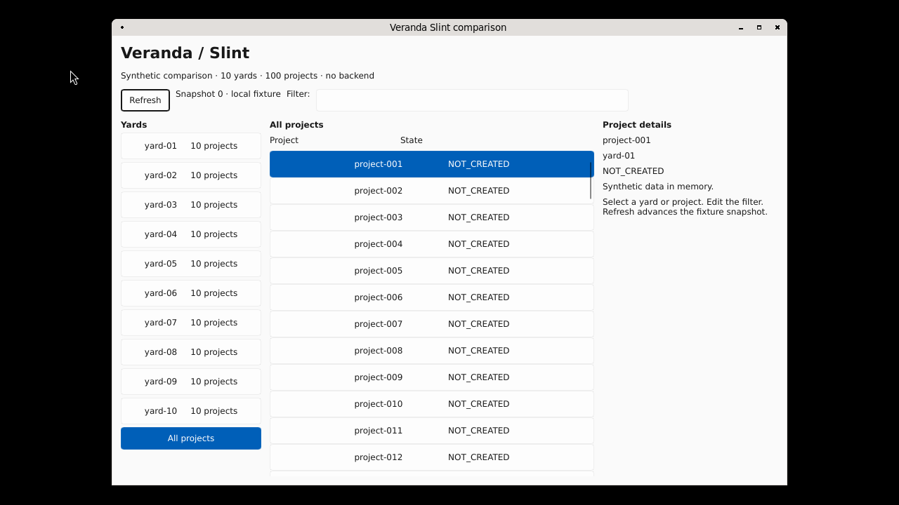
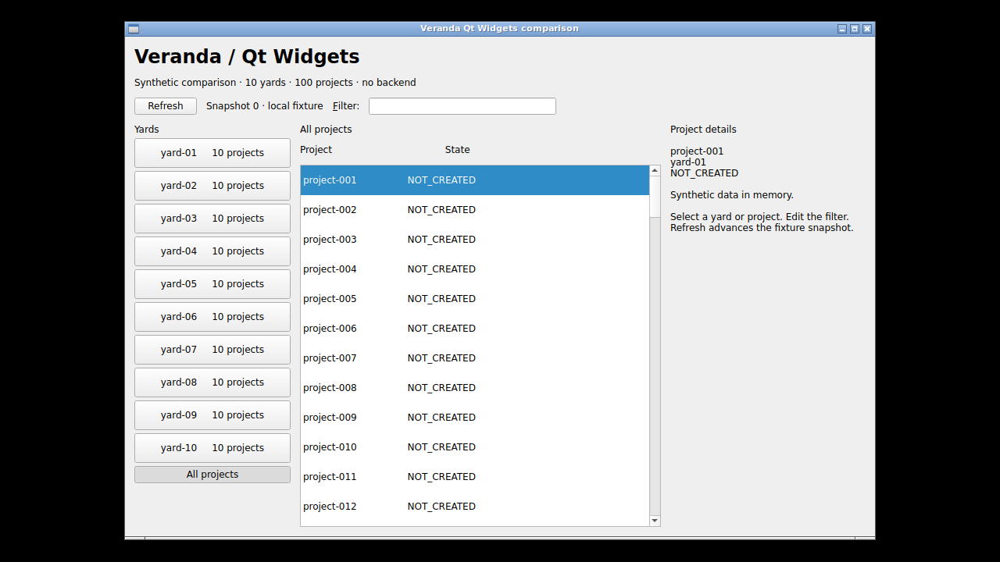
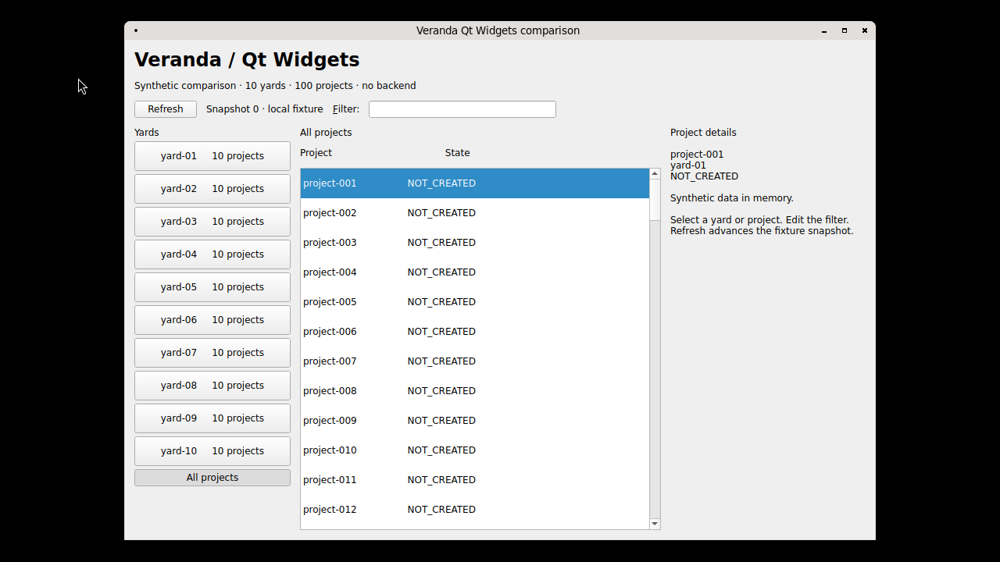
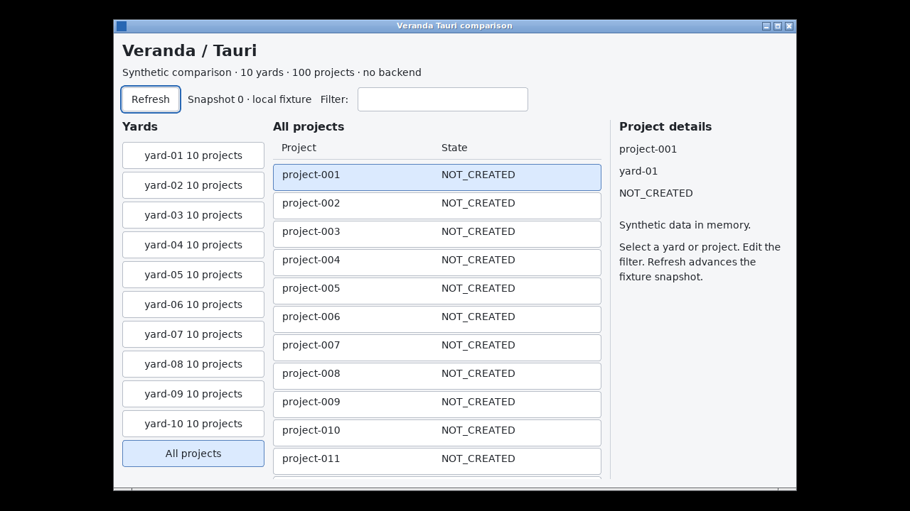
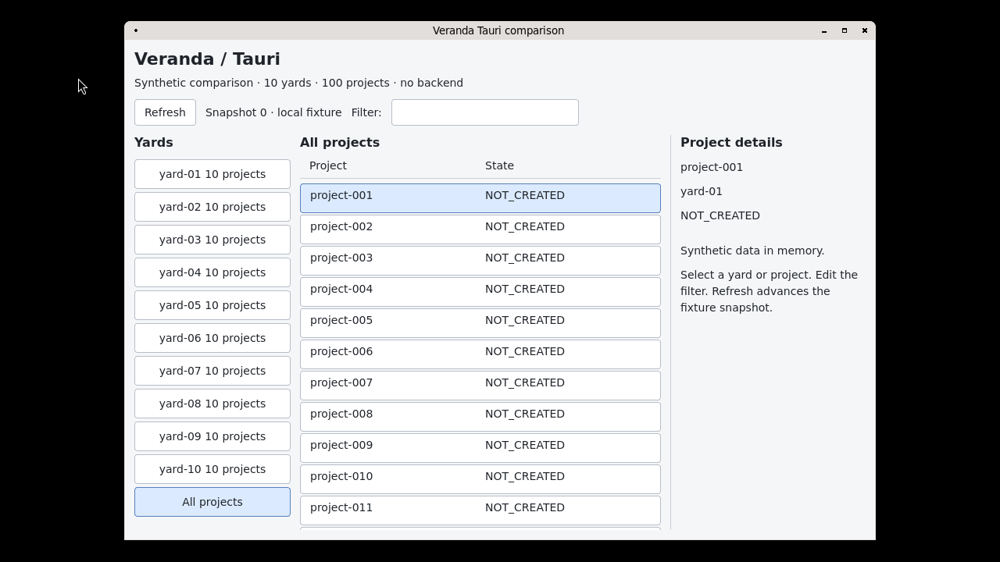

# Linux X11 and native Wayland comparison

All five examples completed paired X11/native Wayland measurements on **one Ubuntu
24.04 runner**, using the same release binary within each pair. The target was
960×640 content with 10 yards, 100 projects, project-001 selected, an empty filter
and snapshot 0. These are visible idle application-family measurements, with the
compositor, window manager, session bus and probe excluded.

[Run 42502969492](https://github.com/HeyVasily/rust-desktop-comparison/actions/runs/42502969492)
completed successfully on 2026-11-08: all ten short preflights and all ten full
cases passed, with clean process cleanup. The job took 37m19s; the full measurement
step took 1570 seconds including startup, settling and cleanup. Executed source:
[`22fb7137a13c78595d4bb366d60e4c859ef57403`](https://github.com/HeyVasily/rust-desktop-comparison/tree/22fb7137a13c78595d4bb366d60e4c859ef57403).
The later platform-support documentation commit did not change the executed inputs.

## Results

Memory is the median over **120 post-baseline observations**, in MiB. Each case
has one additional baseline row and 120 approximately one-second intervals after
30 seconds of settling. RSS sums resident pages across the application family;
PSS apportions shared pages among their current mappings. CPU is the observed
counter increment divided by actual elapsed time, as percent of one logical core.

| Framework | X11 RSS | Wayland RSS | X11 PSS | Wayland PSS | X11 CPU, % | Wayland CPU, % |
| --- | ---: | ---: | ---: | ---: | ---: | ---: |
| egui / eframe | 117.25 | 119.25 | 91.81 | 111.45 | 0.00830 | 0 recorded |
| GTK4 (C) | 181.18 | 185.89 | 151.29 | 172.42 | 0 recorded | 0 recorded |
| Slint | 22.77 | 23.25 | 17.50 | 17.61 | 0 recorded | 0 recorded |
| Qt Widgets | 33.69 | 84.50 | 22.92 | 72.92 | 0 recorded | 0 recorded |
| Tauri | 492.98 | 500.18 | 323.45 | 342.61 | 0.00823 | 0.01644 |

RSS was modestly higher on Wayland for four examples in this run; Qt showed the
largest difference, +50.81 MiB. This single fixed-order run does not establish a
universal display-server ranking. PSS also depends on what the desktop and other
processes share: egui's PSS difference is +19.63 MiB while its RSS difference is
+2.01 MiB. Desktop memory is excluded from the totals but can affect PSS sharing.

The nonzero CPU totals are just 0.01 seconds for egui/X11 and Tauri/X11, and 0.02
seconds for Tauri/Wayland. Zero means no recorded counter increment, rather than
proof of no work. These values do not establish a CPU winner. Actual sampling
windows range from 120.24 to 121.63 seconds; the
[derived CSV](../measurements/linux-display-2026-11-08/derived.csv) retains full precision.

The [earlier 15-case OS matrix](native-matrix-2026-11-07.md) and
[controlled GTK renderer investigation](gtk-memory-investigation.md) remain
separate series. This run observed `GskGLRenderer` on both GTK display backends,
with the default renderer selection intact. Its GTK/X11 181.18 MiB must not be
subtracted from the earlier 238.36 or 240.27 MiB as a backend effect: those captures
used different runs and environment/configuration contexts. This paired series
compares X11 and Wayland within its own runner; it does not repeat the Cairo control.

## What accounts for the Qt difference in the captured mappings

Qt/Wayland's original start and end smaps both contain resident
`libLLVM.so.20.1` (42.293 MiB RSS/PSS) and Mesa Gallium (4.473 MiB RSS/PSS), absent
from Qt/X11's mappings. Those two mapped libraries account for 46.77 MiB of the
50.81 MiB RSS difference. Wayland shared-memory mappings add 4.688 MiB RSS versus
2.344 MiB of Xorg shared memory on X11; QtWaylandClient adds 0.832 MiB, and anonymous
mappings plus heap add 1.023 MiB. Other mappings supply the remaining positive and
negative differences. These are observed resident allocations, not a counterfactual
proof of which initialization call loaded the libraries. The original mapping
snapshots are retained in each [case folder](../measurements/linux-display-2026-11-08/results).

## Environment, backend proof and scope

Ubuntu 24.04.5, GTK 4.14.5, Qt 6.4.2, WebKitGTK 2.52.6, Mesa 25.2.8 and labwc 0.7.1
were installed once. Rust was 1.99.1; the exact package/compiler receipt and resolved
Cargo locks are in [build evidence](../measurements/linux-display-2026-11-08/build).
Egui uses OpenGL and reports llvmpipe (LLVM 20.1.2); Slint uses winit/software;
GTK uses its observed default `GskGLRenderer`; Qt uses its Widgets platform
integration; Tauri uses system GTK/WebKitGTK. `LIBGL_ALWAYS_SOFTWARE=1` is constant;
GSK overrides and GL-disable controls are unset. This is a software-rendered
headless environment, not a hardware-GPU desktop result.

X11 uses Xvfb and Openbox. Wayland uses labwc with its headless backend and Pixman
compositor renderer. Each application receives only its target display connection.
Native backend proof comes from raw display handles for egui, Slint and Tauri,
GDK display classes for GTK, and Qt's actual platform name. A mismatch fails the
case. Labwc's optional Xwayland support is not claimed disabled; every measured
application reported native Wayland in that session, and the recorded Xwayland
process lists are empty.

One-shot application diagnostics require actual 960×640 content before sampling.
The GTK check includes its child/body dimensions, and Tauri verifies 100 project
and 10 yard DOM entries after page load/paint readiness. The same binary hashes
match both backends and both preflight/full phases. Both Cargo backends are built
into the Rust examples; no platform-specific rebuild occurs between paired cases.
The feature-resolution patch is empty in this successful run, and all 32 recorded
source hashes match the published inputs.

The reader runs as UID 0 to read sandboxed helper smaps; GUI applications, display
servers and session buses run as ordinary UID 1001. WebKit sandboxing stays enabled.
Tauri's totals include its main process, WebKitNetworkProcess and WebKitWebProcess.
Other examples have one application process. Those process identities remain
stable throughout all full captures. Family discovery runs at 5 Hz; short-lived
processes between observations and their final CPU increments can be missed.

Cases run sequentially in the order egui, GTK, Slint, Qt, Tauri, X11 then Wayland.
All ten short preflights run before the full cases, using the ordinary runner home
and the same binaries. Font/shader disk caches can therefore be warm: this series
measures post-preflight idle state, not cold first launch. The earlier GTK A/B did
not run that ten-case preflight and used different desktop output dimensions;
those are setup differences, not a proven explanation for its higher GTK RSS.
There is one fresh desktop/session per case, with clean owned-process cleanup
before the next case. This controls the binary, fixture and installed software;
it does not randomize order or eliminate filesystem-cache, font, decoration,
focus or pointer differences. The [capability matrix](platform-support.md) covers
broader framework options: enabling additional integrations can change memory
use, so the resource figures apply to these configured demos.

## Actual interfaces

These are original 1280×720 desktop PNGs with 960×640 application content, displayed
smaller here. All ten full-run end images are byte-identical to their corresponding
start image. Visual inspection confirmed the initial fixture is visible and
unoccluded. Backends differ in decorations, font rendering and focus; egui/X11
also shows a pointer hover. Equivalent fixture state does not imply identical
pixels across backends. Full-size start/end originals remain in each case folder.

<table>
<tr><th>Framework</th><th>X11</th><th>Native Wayland</th></tr>
<tr><th>egui</th><td></td><td></td></tr>
<tr><th>gtk</th><td></td><td></td></tr>
<tr><th>slint</th><td></td><td></td></tr>
<tr><th>qt</th><td></td><td></td></tr>
<tr><th>tauri</th><td></td><td></td></tr>
</table>

## Evidence and reproduction

[Original samples, logs, smaps, screenshots and receipts](../measurements/linux-display-2026-11-08/README.md)
include both the short preflight and full run. The independent derivation checks
120 post-baseline medians and CPU deltas from 121 raw rows, all recorded source
hashes, same-binary pairing, all 56 smaps-to-JSON conversions and all 40 PNG hashes.
Run from the repository root:

```sh
python3 measurements/linux-display-2026-11-08/derive.py
```

To repeat the GUI experiment, use the manual `Linux X11 and Wayland comparison`
[workflow](../.github/workflows/linux-display-comparison.yml), selecting `all`.
It builds each example once, requires all ten short native-backend/content checks
to pass, then runs the 30-second settle and 120-interval cases on that same runner.
The workflow records the actual resolved locks and source hashes before building.
A future runner image/package update is a new environment and must retain its own
receipts. The probe's root/ordinary-user arrangement is intended for the disposable
runner, not the operator's active desktop.

Two earlier attempts produced no full measurements: run
[42495039957](https://github.com/HeyVasily/rust-desktop-comparison/actions/runs/42495039957)
stopped on a stale Cargo lock; run
[42500614629](https://github.com/HeyVasily/rust-desktop-comparison/actions/runs/42500614629)
built all examples but stopped at X11 window discovery because the probe omitted
the case's display environment. Those failures were repaired before this successful
series; their original artifacts remain separate from these measured results.
