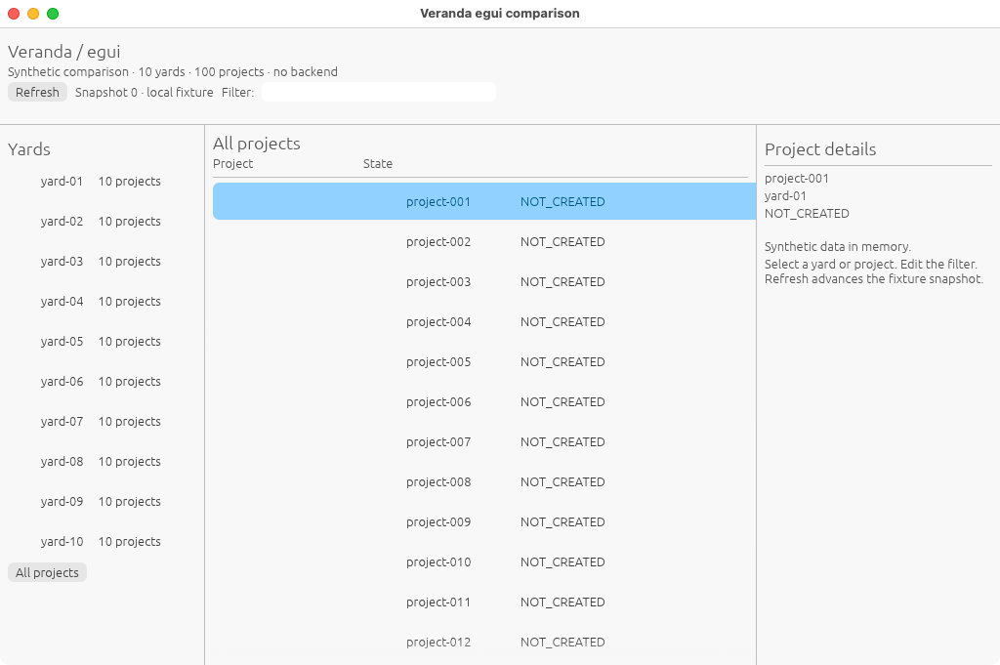
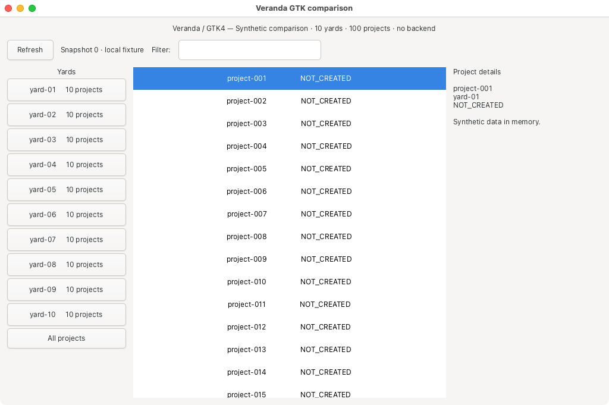
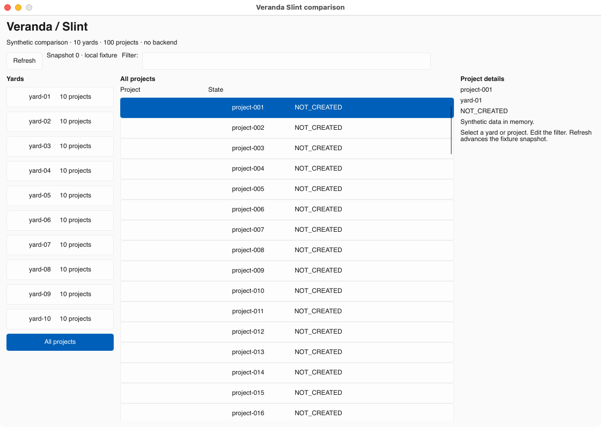
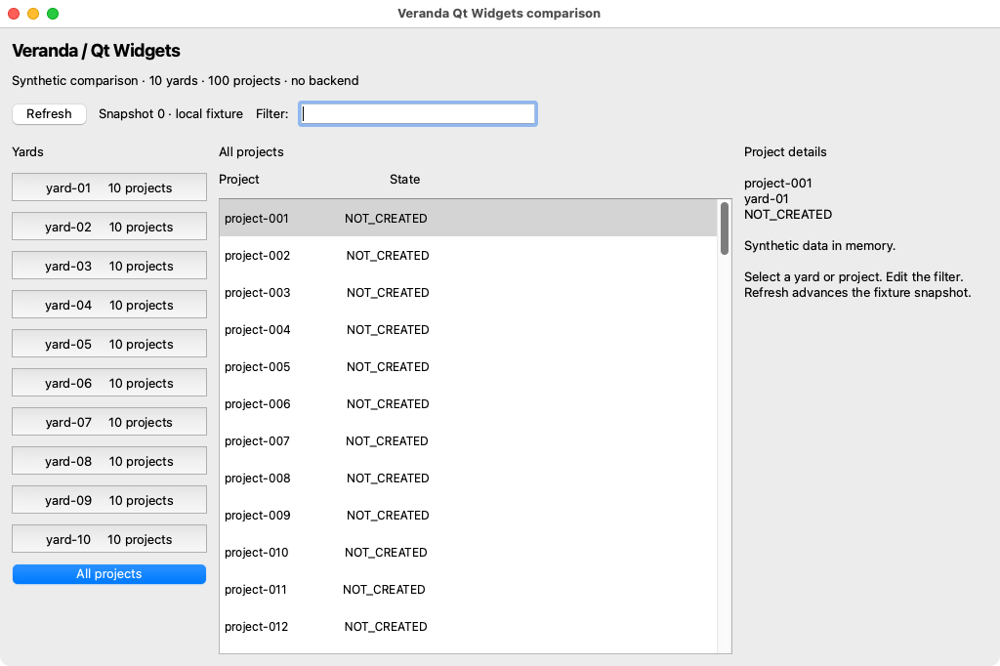
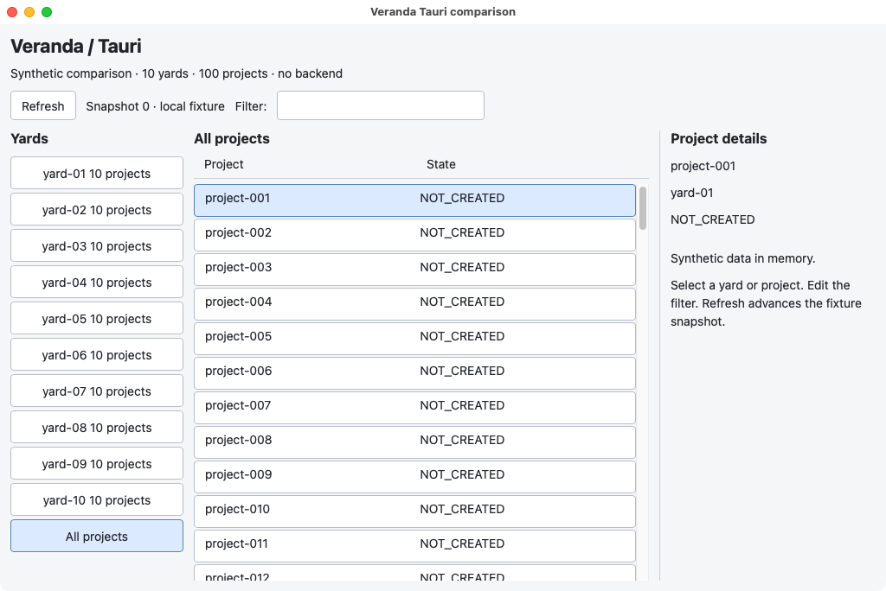

# Native runner observations

These are small synthetic UI observations from actual GitHub-hosted desktop runs.
They are separate from the original Debian/X11 and historical full-backend results.
The [runner procedure](github-runners.md) describes process scope and the difference
between native Working Set/RSS and Linux PSS. No backend or interaction workload is included.

## macOS 15 ARM64 — run 42412948217

[Original run](https://github.com/HeyVasily/rust-desktop-comparison/actions/runs/42412948217),
source commit `4dbcf9ca4eeb88f165a1c4363af6a6a44751ac02`.
macOS 15.8.2, Apple M1 (Virtual), three logical CPUs, 7 GiB RAM, runner image
`20261104.0514.1`. Stock Slint 1.18.1, Qt 6.12.0, GTK4 4.24.1, egui/eframe 0.37.0,
Tauri 2.12.5 and system WebKit `20621.3.11.11.3`.

All five applications built and produced an inspected, useful native-window capture.
For four, the visible comparison phase collected 120 intervals after 30 seconds of
settling. The summaries below were recomputed from the [original raw samples](../measurements/native-42412948217/macos-15/README.md).
Sampling uses one-second delays plus process-monitoring overhead: the 120 intervals
spanned 171.98–177.03 seconds here. CPU is normalized using each phase's actual
monotonic elapsed time, not an assumed 120 seconds.

| Application | Median family RSS, MiB | Observed CPU, % one core | Elapsed, s | PNG size including titlebar | Result |
| --- | ---: | ---: | ---: | --- | --- |
| egui/eframe, Glow | 77.22 | 0.00053 | 171.98 | 1024×681 | Useful UI and comparison samples |
| GTK4 C control | 110.31 | 0.00073 | 176.95 | 1024×681 | Useful UI after warmup; comparison samples |
| Slint, winit/software | 70.27 | 0 recorded CPU increment | 173.38 | 1120×796 | Useful UI and comparison samples |
| Qt Widgets | 88.97 | 0.48539 | 177.03 | 1024×682 | Useful UI and comparison samples |
| Tauri / WKWebView | Not established | Not comparable | — | 1024×684 | Useful UI; process scope incomplete |

Egui reported **Apple Software Renderer** in its actual OpenGL context. Slint requests
software rendering explicitly. The internal GTK and Qt renderers were not instrumented.

These are **not equal-viewport rankings**: the hosted desktop constrained most requested
1120×768 windows to approximately 1024 pixels wide, while Slint retained a larger window.
Actual bounds and capture sizes are retained in each outcome. Default focus also differs:
Qt's filter has a visible text caret, so its CPU value includes the initial focused UI.
There were no input/focus normalization actions or tests of interaction correctness.

GTK's first five-second diagnostic capture contained a black client area; by the end
of that diagnostic, and at both ends of the later 120-interval comparison, the useful UI
was visible. The [initial capture](../screenshots/native-42412948217/macos-15/gtk-initial.png)
is preserved. Its early diagnostic CPU is startup work, not the settled value above.
The nonuniform-image heuristic accepted the titlebar; manual inspection was necessary.
This run does not establish startup or first-paint latency.

Tauri's WKWebView can use launchd/XPC helpers outside its ancestry. Its single-process
subset was sampled for diagnostics, but publishing that subset as total application
memory would omit unknown costs. Full comparison was refused. The native job's final
status is therefore failure despite successful builds and the four useful comparison
phases; see the raw statuses and cleanup limits rather than treating the job as a full pass.

### Actual macOS interfaces

**egui / eframe**

**GTK4 C control, after warmup**

**Stock Slint**

**Qt Widgets**

**Tauri / WKWebView — screenshot only, total memory unknown**

## Windows

The first run built egui, Slint, Tauri and Qt successfully, then stopped before any
application launch: the Qt setup action changed the default Python interpreter, so
the probe could not import Pillow. This was an infrastructure failure, not a framework
measurement. The workflow now pins its probe interpreter and has a
[Windows-only retry](https://github.com/HeyVasily/rust-desktop-comparison/actions/runs/42415220382).
Results remain pending. GTK4 is not configured in this Windows matrix.

## Linux

The Linux job in the original run is still executing. Its new five-framework results
will be recorded separately from the earlier Debian pair; the old numbers do not
measure the new stock Slint, Qt Widgets and Tauri implementations.
