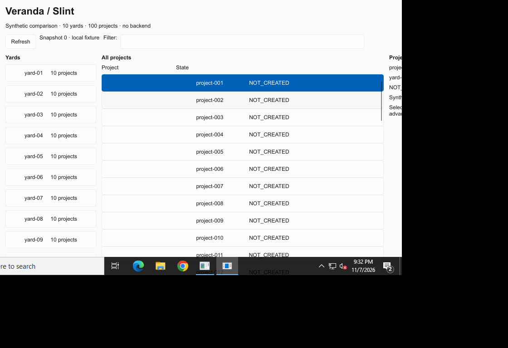
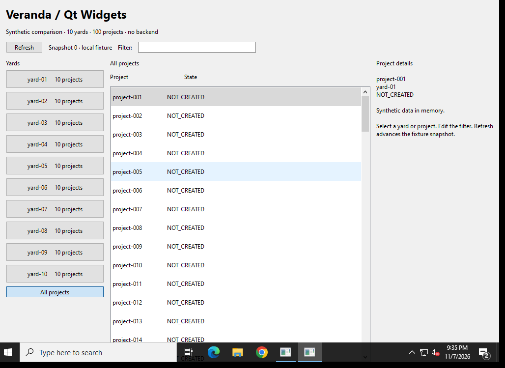
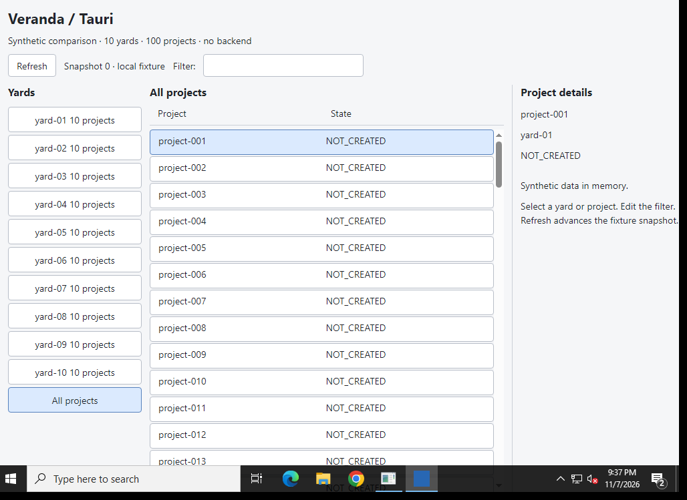
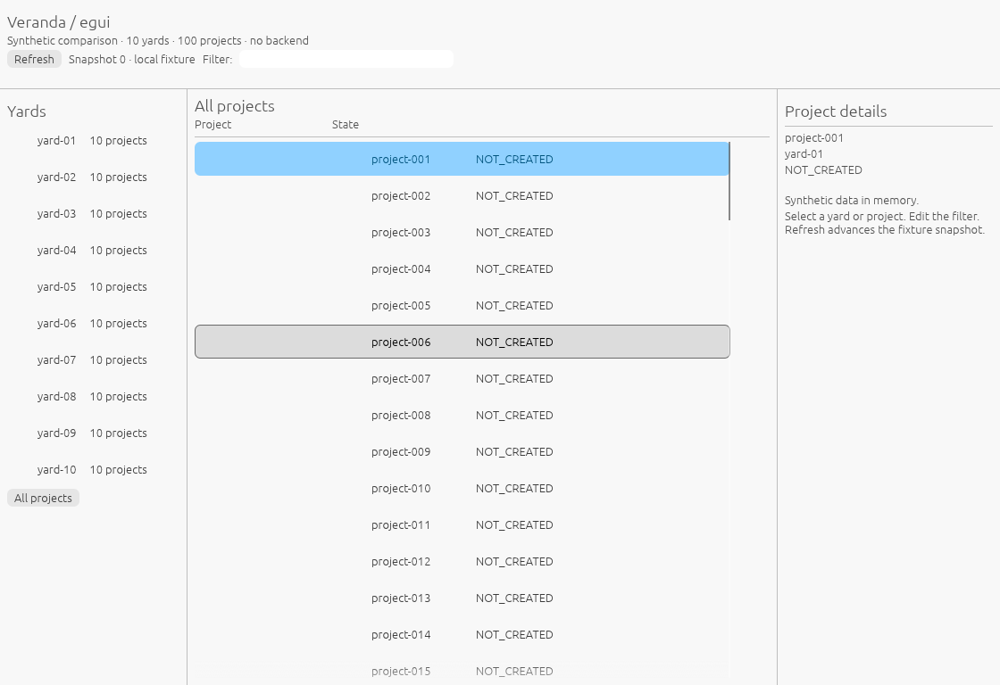
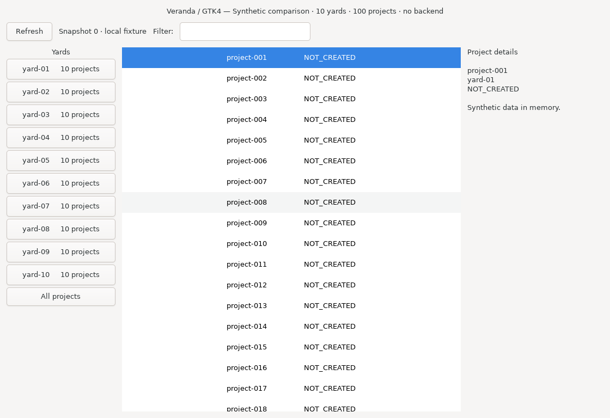
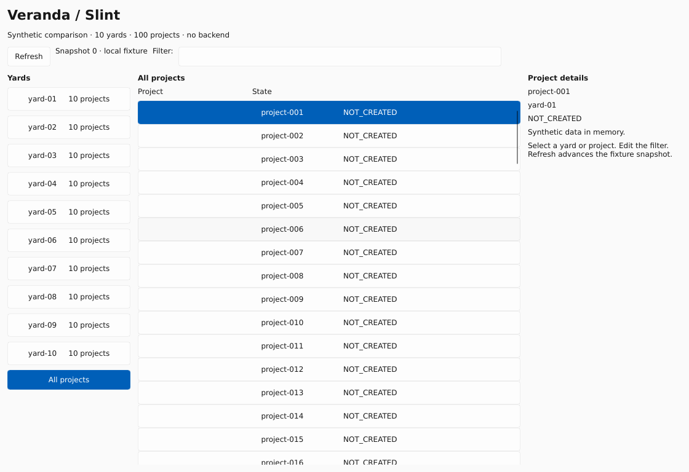
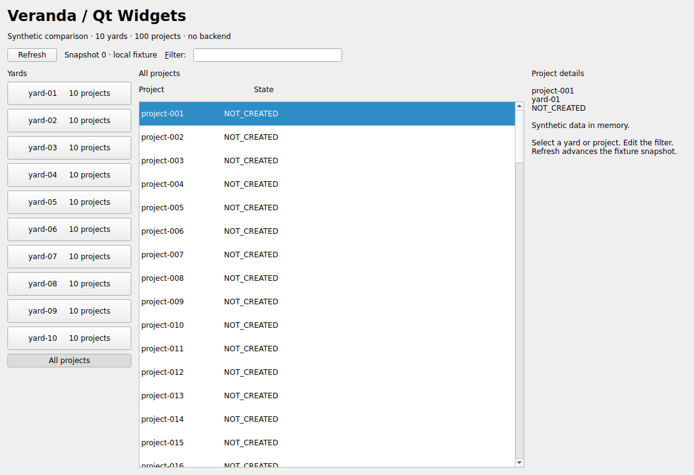
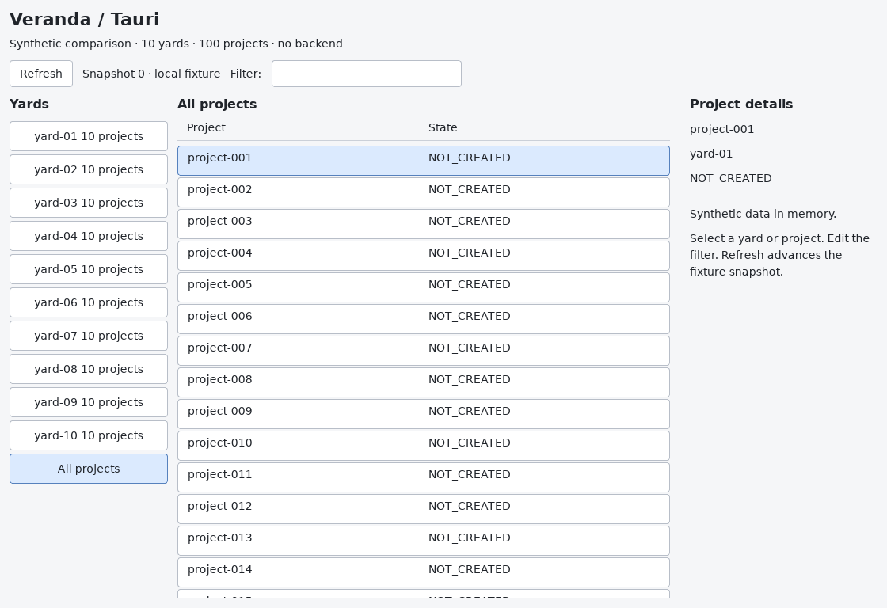

# Native runner observations

These are small synthetic UI observations from actual GitHub-hosted desktop runs.
They are separate from the original Debian/X11 and historical full-backend results.
The [runner procedure](github-runners.md) describes process scope and the difference
between native Working Set/RSS and Linux PSS. No backend or interaction workload is included.

## macOS 15 ARM64 — run 42412948217

[Original run](https://github.com/HeyVasily/rust-desktop-comparison/actions/runs/42412948217),
source commit `4dbcf9ca4eeb88f165a1c4363af6a6a44751ac02`.
macOS 15.8.2, Apple M1 (Virtual), three logical CPUs, 7 GiB RAM, runner image
`20261104.0514.1`. Stock Slint 1.18.1, Qt 6.12.0, GTK4 4.24.1, egui/eframe 0.37.0,
Tauri 2.12.5 and system WebKit `20621.3.11.11.3`.

All five applications built and produced an inspected, useful native-window capture.
For four, the visible comparison phase collected 120 intervals after 30 seconds of
settling. The summaries below were recomputed from the [original raw samples](../measurements/native-42412948217/macos-15/README.md).
Sampling uses one-second delays plus process-monitoring overhead: the 120 intervals
spanned 171.98–177.03 seconds here. CPU is normalized using each phase's actual
monotonic elapsed time, not an assumed 120 seconds.

| Application | Median family RSS, MiB | Observed CPU, % one core | Elapsed, s | PNG size including titlebar | Result |
| --- | ---: | ---: | ---: | --- | --- |
| egui/eframe, Glow | 77.22 | 0.00053 | 171.98 | 1024×681 | Useful UI and comparison samples |
| GTK4 C control | 110.31 | 0.00073 | 176.95 | 1024×681 | Useful UI after warmup; comparison samples |
| Slint, winit/software | 70.27 | 0 recorded CPU increment | 173.38 | 1120×796 | Useful UI and comparison samples |
| Qt Widgets | 88.97 | 0.48539 | 177.03 | 1024×682 | Useful UI and comparison samples |
| Tauri / WKWebView | Not established | Not comparable | — | 1024×684 | Useful UI; process scope incomplete |

Egui reported **Apple Software Renderer** in its actual OpenGL context. Slint requests
software rendering explicitly. The internal GTK and Qt renderers were not instrumented.

These are **not equal-viewport rankings**: the hosted desktop constrained most requested
1120×768 windows to approximately 1024 pixels wide, while Slint retained a larger window.
Actual bounds and capture sizes are retained in each outcome. Default focus also differs:
Qt's filter has a visible text caret, so its CPU value includes the initial focused UI.
There were no input/focus normalization actions or tests of interaction correctness.

GTK's first five-second diagnostic capture contained a black client area; by the end
of that diagnostic, and at both ends of the later 120-interval comparison, the useful UI
was visible. The [initial capture](../screenshots/native-42412948217/macos-15/gtk-initial.png)
is preserved. Its early diagnostic CPU is startup work, not the settled value above.
The nonuniform-image heuristic accepted the titlebar; manual inspection was necessary.
This run does not establish startup or first-paint latency.

Tauri's WKWebView can use launchd/XPC helpers outside its ancestry. Its single-process
subset was sampled for diagnostics, but publishing that subset as total application
memory would omit unknown costs. Full comparison was refused. The native job's final
status is therefore failure despite successful builds and the four useful comparison
phases; see the raw statuses and cleanup limits rather than treating the job as a full pass.

### Actual macOS interfaces

**egui / eframe**

**GTK4 C control, after warmup**

**Stock Slint**

**Qt Widgets**

**Tauri / WKWebView — screenshot only, total memory unknown**

## Windows Server 2022 x64 — run 42415220382

The first run built egui, Slint, Tauri and Qt successfully, then stopped before any
application launch: the Qt setup action changed the default Python interpreter, so
the probe could not import Pillow. This was an infrastructure failure, not a framework
measurement. The workflow now pins its probe interpreter and has a
[completed Windows-only retry](https://github.com/HeyVasily/rust-desktop-comparison/actions/runs/42415220382),
source commit `a829767517c50b839d7496d009eea815cfac3949`.

The retry used four logical CPUs, approximately 16 GiB RAM, runner image
`20261101.353.1`, Qt's requested MSVC kit 6.8.3, Slint 1.18.1, Tauri 2.12.5 and
WebView2 `131.0.2903.86`. Three candidates completed visible comparison sampling.
Their [raw samples and outcomes](../measurements/native-42415220382/windows-2022/README.md)
were independently recomputed before reporting.

| Application | Median family Working Set, MiB | Observed CPU, % one core | Elapsed, s | Process scope |
| --- | ---: | ---: | ---: | --- |
| Slint, winit/software | 23.70 | 0 recorded increment | 122.03 | One process |
| Qt Widgets | 33.13 | 0 recorded increment | 122.02 | One process |
| Tauri / WebView2 | 273.73 | 0.10767 | 130.61 | Nine observed processes, including WebView2 helpers |
| egui/eframe, Glow | Not measured | Not measured | — | Exited before useful window discovery |
| GTK4 C control | Not run | Not run | — | Windows GTK4 runtime/toolchain not configured |

Working Set is not Linux PSS or macOS RSS. Summing processes can double-count shared
pages. Zero increments mean below the observed CPU-counter resolution, not zero work.
Actual elapsed time includes process-discovery overhead.

**Desktop constraint:** the native captures below include taskbar occlusion and clipping.
Slint requested a 1120×768 client positioned partly outside the hosted desktop; its
right and bottom areas were not captured. Qt/Tauri client captures are 1028×749 and
also include the taskbar. The probe's nonuniform-image check passed, but manual review
does not accept these as complete, normalized interface screenshots. The process
samples remain observations of that constrained state, not equal-viewport rankings.
Use the complete macOS gallery above to inspect the layouts. A larger/prepared desktop
is needed for a controlled Windows appearance comparison.

Egui's selected Glow backend reported `egui_glow requires opengl 2.0+` and exited with
status 1. This establishes a limitation of this renderer/runner combination; a WGPU
or separately installed software OpenGL variant was not tested. GTK4's explicit
`not_run` is a missing toolchain configuration, not a platform-support verdict.
The retry's enclosing job failed because a configured candidate, egui, failed its
diagnostic. It was not a full green matrix despite the three completed sample sets.

### Constrained Windows captures

**Slint — right/bottom clipped, taskbar present**

**Qt Widgets — taskbar overlaps the client capture**

**Tauri / WebView2 — taskbar overlaps the client capture**

## Linux

### Ubuntu 24.04 x64 — run 42412948217

The [original run's Linux job](https://github.com/HeyVasily/rust-desktop-comparison/actions/runs/42412948217/job/128524807125)
completed successfully: all five builds, diagnostics, visible/minimized comparisons,
cleanup and required checks passed. Its enclosing matrix remains failed because the
earlier Windows job had an infrastructure failure and macOS Tauri had incomplete scope.

Source commit `4dbcf9ca4eeb88f165a1c4363af6a6a44751ac02`; Ubuntu runner image
`20261101.360.1`, four logical CPUs and approximately 16 GiB RAM. Xvfb/Openbox used
a 1600×1000 X11 desktop. All five inspected client captures are **1120×768**, with
the complete interface visible. Initial selection/hover/focus were not normalized;
this is a quiet initial-UI workload, not an interaction or peak-memory benchmark.

Versions: egui/eframe 0.37.0, GTK4 4.14.5, stock Slint 1.18.1, Qt Widgets 6.4.2,
Tauri 2.12.5 and WebKitGTK 2.52.6. Mesa 25.2.8 reported
**llvmpipe (LLVM 20.1.2, 256 bits)**, without acceleration. Egui's context reported
the same renderer. Slint explicitly selects software rendering. Internal GTK/Qt/
WebKit renderer types were not instrumented; `LIBGL_ALWAYS_SOFTWARE=1` was requested.

| Application | Visible median family RSS, MiB | Minimized median family RSS, MiB | Visible CPU, % one core | Minimized CPU, % one core |
| --- | ---: | ---: | ---: | ---: |
| egui/eframe, Glow | 121.73 | 121.73 | 0 recorded increment | 0.00817 |
| GTK4 C control, default renderer | 242.42 | 242.42 | 0 recorded increment | 0 recorded increment |
| Slint, winit/software | 23.97 | 23.97 | 0 recorded increment | 0.00817 |
| Qt Widgets | 34.53 | 34.53 | 0 recorded increment | 0 recorded increment |
| Tauri / WebKitGTK | 519.56 | 506.41 | 0.01582 | 0.03166 |

Each phase used 30 seconds of settling and 120 intervals. Actual visible/minimized
elapsed times were about 122.40–122.54 seconds for the single-process examples and
126.35–126.43 seconds for Tauri. CPU calculations use those actual durations.
Tiny/zero CPU counter increments do not establish a significant CPU ranking.

Tauri had three observed process identities; its figures include the observed webview
family. Summed RSS double-counts shared pages and is not PSS. Process discovery can
miss very short-lived children, and shared system services are excluded as documented
in each raw outcome. The other four examples had one observed process each.
Minimized state was checked with both X11 hidden and unmapped state before/after sampling.

The GTK result is **not the earlier Cairo-requested Debian result**: this run used
GTK's uninstrumented default renderer, a different GTK/Mesa version and a different
environment. The difference does not establish a toolkit regression or a causal
memory effect of any renderer change. Likewise, the old patched Slint and full-backend
Tauri results describe different implementations. Compare within a recorded series.

See [the original raw samples and versions](../measurements/native-42412948217/ubuntu-24.04/README.md).

### Actual Linux interfaces

**egui / eframe**

**GTK4 C control**

**Stock Slint**

**Qt Widgets**

**Tauri / WebKitGTK**

