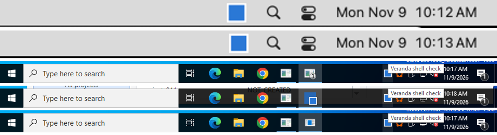

# Shell integration on real runners, 2026-11-09

The [feature matrix](features.md) says what each framework *documents* for the Dock,
taskbar, tray and launch behaviour. This report checks part of it on GitHub-hosted
Windows Server 2022, macOS 15 and Ubuntu 24.04 runners: each example was built with
an optional `shell-checks` feature, asked to set up the feature, and the effect was
looked for **from outside the app**, the way the desktop would see it.

Runs: [42596721572](https://github.com/HeyVasily/rust-desktop-comparison/actions/runs/42596721572)
(Windows, macOS) and [42607693065](https://github.com/HeyVasily/rust-desktop-comparison/actions/runs/42607693065)
(Linux, after a probe fix). Raw results: [summary.csv](../measurements/shell-checks-2026-11-09/summary.csv)
and one `result.json` plus application log per OS and framework under
[measurements/shell-checks-2026-11-09](../measurements/shell-checks-2026-11-09/).

## Results

✅ effect observed · ☑️ the app's call succeeded but the OS gives no outside view ·
— the framework has no API (no own platform code was written) · ❌ not observed

| Framework | Tray icon | Badge | Attention | Global shortcut | Single instance |
| --- | :---: | :---: | :---: | :---: | :---: |
| egui / eframe | ✅&nbsp;Win ✅&nbsp;mac ✅&nbsp;Linux | —&nbsp;Win —&nbsp;mac —&nbsp;Linux | ✅&nbsp;Win ☑️&nbsp;mac ✅&nbsp;Linux | ✅&nbsp;Win ✅&nbsp;mac ✅&nbsp;Linux | ✅&nbsp;Win ✅&nbsp;mac ✅&nbsp;Linux |
| GTK4 (gtk4-rs) | ✅&nbsp;Win ✅&nbsp;mac ✅&nbsp;Linux | —&nbsp;Win —&nbsp;mac —&nbsp;Linux | —&nbsp;Win —&nbsp;mac ✅&nbsp;Linux | ✅&nbsp;Win ❌&nbsp;mac ✅&nbsp;Linux | ✅&nbsp;Win ❌&nbsp;mac ✅&nbsp;Linux |
| Slint | ✅&nbsp;Win ✅&nbsp;mac ✅&nbsp;Linux | —&nbsp;Win —&nbsp;mac —&nbsp;Linux | ✅&nbsp;Win ☑️&nbsp;mac ✅&nbsp;Linux | ✅&nbsp;Win ✅&nbsp;mac ✅&nbsp;Linux | ✅&nbsp;Win ✅&nbsp;mac ✅&nbsp;Linux |
| Qt Widgets | ✅&nbsp;Win ✅&nbsp;mac ✅&nbsp;Linux | ☑️&nbsp;Win ✅&nbsp;mac —&nbsp;Linux | ✅&nbsp;Win ☑️&nbsp;mac ❌&nbsp;Linux | —&nbsp;Win —&nbsp;mac —&nbsp;Linux | ✅&nbsp;Win ✅&nbsp;mac ✅&nbsp;Linux |
| Tauri | ✅&nbsp;Win ✅&nbsp;mac ✅&nbsp;Linux | ☑️&nbsp;Win ✅&nbsp;mac ✅&nbsp;Linux | ✅&nbsp;Win ☑️&nbsp;mac ✅&nbsp;Linux | ✅&nbsp;Win ✅&nbsp;mac ✅&nbsp;Linux | ✅&nbsp;Win ✅&nbsp;mac ✅&nbsp;Linux |

What each example used:

| Framework | Tray | Badge | Attention | Shortcut | Single instance |
| --- | --- | --- | --- | --- | --- |
| egui | tray-icon crate (ksni on Linux) | — | `ViewportCommand::RequestUserAttention` | global-hotkey crate | single-instance crate |
| GTK4 | tray-icon crate (ksni on Linux) | — | Linux: `gdk_x11_surface_set_urgency_hint` | global-hotkey crate | `GApplication` uniqueness |
| Slint | built-in `SystemTrayIcon` | — | winit via `WinitWindowAccessor` | global-hotkey crate | single-instance crate |
| Qt | `QSystemTrayIcon` | `setBadgeNumber` (Qt ≥ 6.5) | `QApplication::alert` | — | `QLocalServer` (own code) |
| Tauri | `TrayIconBuilder` | `set_badge_count`, Windows `set_overlay_icon` | `request_user_attention` | global-shortcut plugin | single-instance plugin |

*Top: the macOS menu bar with the Qt and Tauri status items. Below: the Windows
taskbar for Qt (overlay “3” on the taskbar button), Tauri (overlay icon) and Slint,
each with the tray tooltip “Veranda shell check”. Full screenshots per OS and
framework are in [screenshots/shell-checks-2026-11-09](../screenshots/shell-checks-2026-11-09/).*

## Findings

- **Tray icons work everywhere, including GTK 4** through the tray-icon crate's
  ksni backend, which talks StatusNotifierItem over D-Bus without GTK 3.
  Clicks on the icon reached every app on Windows (a real mouse click) and Linux
  (D-Bus `Activate`) **except Tauri on Linux**: its AppIndicator item has no
  `Activate` method, so only the menu works, as Tauri documents. macOS clicks were
  not attempted (posting mouse events needs Accessibility permission).
- **Badges**: Qt showed “3” in the macOS Dock (`lsappinfo` StatusLabel) and as a
  Windows taskbar overlay; Ubuntu's Qt 6.4 predates `setBadgeNumber`. Tauri set the
  Dock label on macOS, an overlay icon on Windows, and on Linux sent a
  `com.canonical.Unity.LauncherEntry` count — only because the test session owned
  `com.canonical.Unity` the way Unity-compatible docks do and libunity was installed.
  egui, GTK and Slint have no badge API.
- **Attention**: Windows flashes were observed as `HSHELL_FLASH` shell-hook messages
  for egui, Slint, Qt and Tauri; Linux urgency hints for egui, GTK, Slint and Tauri.
  **Qt 6.4 on X11 set neither the urgency hint nor `_NET_WM_STATE_DEMANDS_ATTENTION`**
  after `QApplication::alert` on an inactive window under Openbox; the cause was not
  isolated. GTK 4 has no attention call on Windows or macOS. A Dock bounce is not
  visible to other processes, so macOS shows ☑️.
- **Global shortcut**: the global-hotkey crate and Tauri's plugin received a
  synthetic Ctrl+Alt+Shift+F9 on all three systems, **except under GTK on macOS**:
  registration succeeded but the key never arrived; the cause was not isolated
  (the same crate works under winit and Tauri on that runner). Linux is X11 only; Wayland
  needs the GlobalShortcuts portal. Qt has no API.
- **Single instance**: every second launch exited. `GApplication` forwarded the
  launch to the first instance on Linux **and Windows**, but **not on macOS**, where
  without a D-Bus session bus the second launch became a separate primary instance.
  The crate-based egui and Slint checks only detect the first instance; Qt
  (`QLocalServer`) and Tauri's plugin also forward to it.

## Method and limits

- Linux ran under Xvfb with Openbox in a private D-Bus session. A minimal
  [StatusNotifierWatcher](../tools/sni_watcher.py) stood in for a desktop panel; real
  GNOME needs the AppIndicator extension for any of these tray icons.
- Windows Explorer was set to show all notification-area icons (`EnableAutoTray=0`);
  the probe read Explorer's tray toolbars to find the icon owned by the app.
- Attention was requested 50 s after start, after the window had been minimized
  (Windows) or another window activated (Linux).
- Checks marked — were not implemented with own platform code; the
  [feature matrix](features.md) shows where such code is possible.
- The crate-based results test the crate *inside that framework's event loop*, not
  the framework's own API.
- Adding the optional dependencies re-resolved one shared lock entry in the egui
  example (`os_pipe` now uses `windows-sys` 0.61); the measured builds do not enable
  the feature.
- Not covered: autostart, URL schemes and file associations, window materials and
  credential stores. These need installation or are identical across frameworks.

Reproduce: run the *Shell integration checks* workflow, download its artifacts and
`python3 tools/import_shell_run.py <series> <artifacts>`. The probe is
[tools/shell_probe.py](../tools/shell_probe.py); the app side is
[examples/shell_common.rs](../examples/shell_common.rs), each example's `shell` module
and [examples/qt/shell_checks.h](../examples/qt/shell_checks.h).
